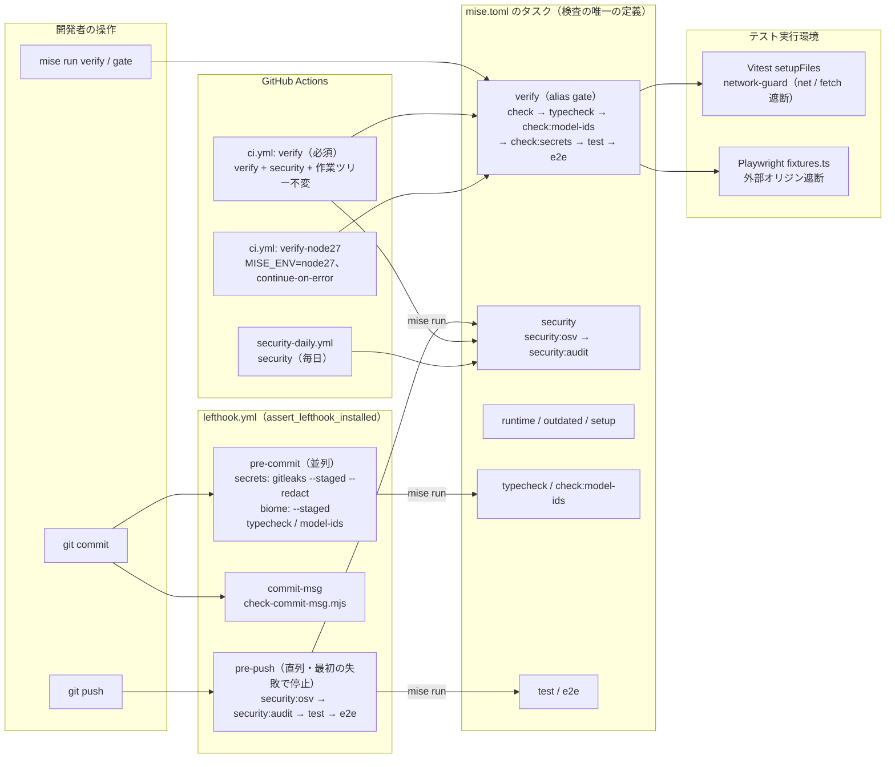
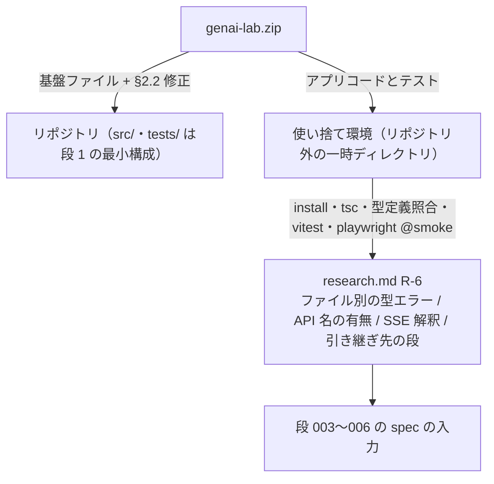
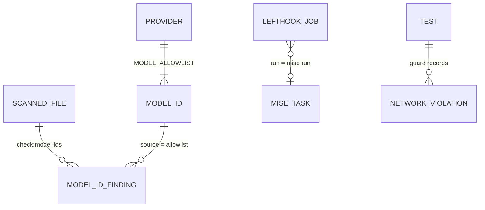

# 001-dev-environment-and-gates — Technical Plan

承認済みの要件（WHAT）を設計（HOW）に落とす。実装コードは含まない。根拠は
[research.md](research.md)（I-n は調査、ADR-n は設計判断、R-n は実装時の記録）。

## Summary

ZIP 足場の基盤ファイルを plan §2.2 の修正と本 spec の決定（Clarifications の全セッション）を反映して取り込み、
`mise.toml` のタスクを唯一の検査定義とする。`verify`（別名 `gate`）はオフラインで決定論的な検査を
直列に実行し、ネットワークが必要な検査は `security` に分ける。lefthook のフックと CI はこれらの
タスクを呼ぶだけにして、検査の二重定義をなくす（ADR-1、ADR-2）。

アプリは RSC のプレースホルダーページ 1 枚だけを持つ。unit / E2E の実行環境は依存を足さずに
未モック通信を失敗させ（ADR-5）、ゲート自体を壊すと落ちる自己検査テストを置く。秘密値を含む commit の
拒否は、実行時に生成した偽キーで一時リポジトリを検査する自動テストで確かめる（Requirement 8）。
ZIP のアプリコードは使い捨て環境で型照合し、結果だけを research.md に残す（ADR-9）。

## Architecture Overview

- **検査の定義は `mise.toml` に 1 か所**。フックと CI はタスク名で呼ぶ。素のコマンドを書くのは
  staged 専用の 2 ジョブ（gitleaks、Biome）だけで、設定テストがフックとタスクの対応を検査する（ADR-2）。
- **verify はオフライン**。構成要素は lint / format（Biome）、型検査（`next typegen && tsc`）、
  `check:model-ids`、gitleaks 全履歴、unit、E2E `@smoke`。ネットワークを使うのは `security` と、
  CI の install 工程だけ（3.6、NFR）。
- **既定レーンと Node 27 レーン**は同じタスクを使い、`MISE_ENV=node27` で node の版だけが変わる
  （11.1、11.4）。
- **ゲートの自己検査**: 0 件実行、未モック通信、モデル ID 直書き、秘密値 commit、フックのツール不在を、
  実設定を使う自動テストで「違反すると非 0 になる」ことまで確かめる（9.4〜9.7）。

段 1 で取り込まない ZIP のアプリコードは、リポジトリ外の使い捨て環境で検証する（ADR-9）。

## Components

各コンポーネントの「Does NOT own」は tasks.md の `_Boundary:_` が参照する契約である。複数の
コンポーネントが同じファイルを持つ場合（`mise.toml` など）は、ファイル内の担当範囲で分ける。

### C1 ToolchainPins (DES-1.1)

- **Responsibility**: ランタイム・ツール・npm 依存の採用版を exact に固定し、24h ゲートと install
  スクリプトの遮断を設定で強制する。
- **Public interface**:
  - `mise.toml` の `[tools]`: `node`、`pnpm`、`lefthook`、`gitleaks`、`osv-scanner` を exact 版で指定。
    `[env]` に `NEXT_TELEMETRY_DISABLED = "1"`。ZIP の `[settings] prereleases = false` は既定値なので書かない。
  - `package.json`: `name`、`private: true`、`type: "module"`、`packageManager: "pnpm@<mise と同じ版>"`、
    `engines.node: ">=<Node 26 LTS の採用版> || >=27.0.0-alpha"`（semver で alpha を受けるため。I-2）、
    `scripts`（`dev`、`build`、`start` のみ。検査は mise タスクに一本化し、`package.json` に検査スクリプトを
    重複させない）、`dependencies` / `devDependencies` は ADR-4 の一覧を exact 版で（下の「宣言する依存」）。
  - `pnpm-workspace.yaml`: `minimumReleaseAge: 1440`、`minimumReleaseAgeStrict: true`、`strictDepBuilds: true`（どちらも pnpm の既定値だが、既定が変わっても gate が弱まらないよう明記する。I-8）、`savePrefix: ""`（`pnpm add` が `^` を付けない）、
    `allowBuilds`（install スクリプトを持つ依存を**すべて**列挙し、各行に理由のコメント。`sharp: false`）、
    必要な場合だけ `overrides` と `audit.ignore`（C4）。`minimumReleaseAgeExclude` は書かない。
  - `pnpm-lock.yaml`: `pnpm install` で生成し、CI は `--frozen-lockfile`。
  - **宣言する依存**（原則 10。この節が段 1 の宣言の正本で、根拠は ADR-4）:
    - `dependencies`: `next`、`react`、`react-dom`。
    - `devDependencies`: `@biomejs/biome`、`@playwright/test`、`typescript`、`vitest`、`@types/node`、
      `@types/react`、`@types/react-dom`。
    - plan §2 の技術スタック表にない**新規の宣言**は `@types/node`・`@types/react`・`@types/react-dom` の 3 つ
      （`typescript` は同表の TypeScript、他は Next.js / React / Biome / Vitest / Playwright の行にあたる）。
      3 つは型検査（`strict`、`types: ["node"]`、RSC のページ）に必須で、標準ライブラリや既存依存では代替できない。
    - 入れない依存: `ai`、`@ai-sdk/*`、`zod`、`@vitejs/plugin-react`、`server-only`（段 002 以降の plan で宣言する）。
    - CI の Actions（`actions/checkout`、`jdx/mise-action`）は plan §3.2・§8.5 の CI ジョブの構成要素で、版は
      research.md R-1 に記録する。`actionlint` などの補助ツールは依存に加えない。
- **Owns**: 採用版の正本（設定と lockfile）。`allowBuilds` の判断と理由。
- **Does NOT own**: タスク定義（C3〜C5）、Node 27 の版（C14）、採用根拠の記録（C15 の research.md R-1・R-2）。
- **Requirements**: 1.1, 1.2, 1.3, 1.4, 1.5, 1.6, 1.7, 1.8, 1.9, 11.1

### C2 StaticAnalysisConfig (DES-1.2)

- **Responsibility**: lint / format / 型検査の規約を `biome.json` と `tsconfig.json` に集約する。
- **Public interface**:
  - `biome.json`: `linter.rules.preset: "recommended"`（I-9）、`correctness.noUnusedVariables` /
    `correctness.noUnusedImports` / `suspicious.noExplicitAny` を `"error"`。`suspicious.noSkippedTests` も
    `"error"`（Biome 2.6.8 に実在する。`it.skip` / `describe.skip` / テスト本体内の `test.skip(…)` を検出し、
    `it.todo` と `test.info().skip(…)` は検出しないことを実測した（I-15）。`.fixme` / `xit` は未確認。静的な検査は
    1 段目で、実行 0 件の最終的な止め手は 2 つの reporter（C6・C7）。3.8、3.9）。
    `vcs.enabled: true`、`vcs.clientKind: "git"`、`vcs.useIgnoreFile: true`（`--staged` と ignore の読み込みに
    `enabled` と `clientKind` が要る。ZIP の値を保つ）。
    `files.includes` はコード・JSON・設定に限り、`specs/`・`.sdd/`・`docs/` の Markdown は対象にしない。
    `overrides` で `tests/e2e/**`（`tests/e2e/fixtures.ts` を除く）の `@playwright/test` 直接 import を
    `noRestrictedImports` で禁止する（ADR-5）。
  - `tsconfig.json`: ZIP の値を基に `strict: true`、`noUncheckedIndexedAccess: true`、`noEmit: true`、
    `types: ["node"]`、`paths: { "@/*": ["./src/*"] }`。`include` に `next-env.d.ts`、`src/**`、`tests/**`、
    `*.config.ts`、`.next/types/**/*.ts`。`next dev` が書き足す値は取り込み時に受け入れて固定する（I-11）。
  - `next.config.ts`: ZIP の内容（`cacheComponents: true`）を型検査が通る形で取り込む。
- **Owns**: 規約の値。
- **Does NOT own**: 規約を実行するタスク（C3 の `check` / `typecheck`）、フックでの staged 実行（C9）。
- **Requirements**: 2.1, 2.2, 2.3, 2.4, 2.5, 3.8, 3.9

### C3 VerifyTask (DES-1.3)

- **Responsibility**: オフラインで決定論的な検査を、`mise run verify`（別名 `gate`）1 つで直列に実行する。
- **Public interface**（`mise.toml` の `[tasks.*]`、詳細は Interfaces の表）:
  `check`、`typecheck`、`check:model-ids`、`check:secrets`、`test`、`e2e`、`verify`（`alias = "gate"`）。
  `verify` は `run` 配列で 6 タスクをこの順に呼び、最初の失敗で止まる（ADR-1、I-3）。他のタスクを呼ぶ
  `verify` と `security` は `{ task = "<name>" }` の書き方で書く。`mise tasks ls --json` では `{"task":"<name>"}`
  というオブジェクトになり、通常のコマンドは単一の文字列でも `["pnpm exec vitest run"]` のように配列になる
  （I-16）。
- **Owns**: verify の構成要素・順序・判定基準（gitleaks の `--redact`、Vitest / Playwright の呼び方）。
- **Does NOT own**: ネットワークが必要な検査（C4）、テストランナーの設定（C6・C7）、モデル ID 検査の中身（C8）。
- **Requirements**: 2.4, 2.5, 3.1, 3.2, 3.3, 3.4, 3.5, 3.6, 3.7, 3.12, 11.4

### C4 SecurityTask (DES-1.4)

- **Responsibility**: ネットワークを使う依存の脆弱性検査を verify から分けて実行し、到達不能を成功扱いに
  しない。
- **Public interface**: `security:osv`（`osv-scanner scan source --lockfile=pnpm-lock.yaml`）、
  `security:audit`（`pnpm audit --audit-level=high`、`--ignore-registry-errors` は付けない）、
  `security`（`security:osv` → `security:audit` の直列）。
  除外を記録する場合の形式: osv-scanner は `osv-scanner.toml` の `[[IgnoredVulns]]`（`id`、`ignoreUntil`、
  `reason` に退役条件を含める）、pnpm は `pnpm-workspace.yaml` の `audit.ignore`（GHSA ID の各行に
  理由と退役条件のコメント）。除外がない間はどちらも作らない。
- **Owns**: security の構成要素と除外の記録形式。
- **Does NOT own**: CI での実行タイミング（C13）、フックでの実行（C9）、版上げ自体（C1）。
- **Requirements**: 4.1, 4.2, 4.3, 4.4, 4.5

### C5 AuxiliaryTasks (DES-1.5)

- **Responsibility**: 合否と切り離した記録用・更新確認用・セットアップ用のタスクを提供する。
- **Public interface**:
  - `runtime`: `node -v`、`pnpm -v`、`pnpm exec tsc -v`、`pnpm exec next --version`、`lefthook version`、
    `gitleaks version`、`osv-scanner --version` を出力する。期待値と照合しない。
  - `outdated`: `mise outdated`（ツール）→ `pnpm outdated`（npm 依存）。ファイルを変更しない。
    `pnpm outdated` は候補があると `exit 1` になる（I-8）。この意味を `description` と README に書き、
    終了コードを隠さない。
  - `setup`: `pnpm install --frozen-lockfile` → `pnpm exec playwright install chromium` → `lefthook install`。
    README のセットアップ手順の最後の 3 手順をまとめる。
- **Owns**: 上記 3 タスク。
- **Does NOT own**: 版の決定（C1）、検査の合否（C3・C4）。
- **Requirements**: 1.8, 5.1, 5.2, 5.3, 5.4, 13.3

### C6 UnitTestHarness (DES-1.6)

- **Responsibility**: unit テストの実行環境を、0 件で失敗し、未モック通信でテストが失敗する状態に固定する。
- **Public interface**:
  - `vitest.config.ts`: `include: ["tests/unit/**/*.test.ts"]`、`environment: "node"`、
    `setupFiles: ["tests/unit/setup/network-guard.ts"]`、`passWithNoTests: false`（既定と同じ値を明記）、
    `allowOnly: false`、`resolve.alias` の `@` → `src`。`@vitejs/plugin-react` は使わない（ADR-4）。
    `reporters: ["default", "./tests/unit/setup/require-executed-tests.ts"]`。`testTimeout` は既定（5 秒）の
    まま、子プロセスを使うテストファイルは `describe(…, { timeout })` で明示する（初期値 60 秒、R-11 の
    実測で見直す）。
  - `tests/unit/setup/require-executed-tests.ts`: Vitest の custom reporter。実行を終えたテスト
    （passed + failed）が 0 件なら、実行全体を失敗させる（ファイルはあるが全部 `todo` / `skip` の場合。
    3.8）。`vitest/node` の `Reporter` を実装し、`onTestRunEnd(testModules)` で各モジュールの
    `children.allTests()` の `result().state` が `passed` / `failed` の件数を数え、0 件なら固定メッセージ
    `no tests were executed` を stderr に出して `process.exitCode = 1` にする。Vitest 5.1.1 で実測済み
    （`.ts` の reporter を読み込めること、`it.todo` のみ → 1、`it.skip` のみ → 1、1 件実行 → 0。reporter なしで
    `it.todo` のみだと 0 で、reporter が唯一のガードであること。I-15）。型検査は実装時に通す。自己検査（C12）で
    非 0 になることを確かめる。
  - `tests/unit/setup/network-guard.ts`: `net.Socket.prototype.connect` と `globalThis.fetch` を置き換え、
    呼ばれると `UnmockedNetworkError` を投げて違反を記録する。`afterEach` で違反があればそのテストを
    失敗させる。違反の消去手段は公開しない（ADR-5）。
  - `tests/unit/helpers/sandbox.ts`: `useTempGitRepo()`（一時ディレクトリ + `git init`、終了時に
    `onTestFinished` で必ず削除）、`resolveTool(name)`、`isolatedEnv(options?)`、`runCommand()`（シェルを介さない
    `spawnSync`、タイムアウト付き（既定 30 秒、テストの timeout より短く）、`CommandResult` を返す）、
    `expectGateFailure()` / `expectGateSuccess()`。
    - `resolveTool(name)`: 解決元を 2 種に分け、どの名前がどちらかを 1 か所の表で持つ。
      (1) mise 管理のツール（`node`、`pnpm`、`gitleaks`、`lefthook`、`osv-scanner`）: リポジトリのルートを cwd に
      して `mise which <name>` を 1 回だけ実行し、絶対パスを返す。
      (2) mise 管理外のツール（`git`、`mise` 自身）: `git` は `[tools]` に入れない設計（C1 の 5 ツール）、`mise` は
      `mise which` で自分自身を解決できないため、どちらも `mise which` では解決できない（I-16）。親プロセスの
      `PATH` を先頭から探し、実行可能な絶対パスを返す（子プロセスは使わない）。`mise` の呼び出しは cwd を
      リポジトリのルートにして行う（`mise.toml` を読むため）。
      node_modules の bin（`biome`、`tsc`、`vitest`）はルートの `node_modules/.bin/` から解決する。これらは
      shebang のスクリプトで、実行には `node` が PATH に要る（I-16）。mise の shim は cwd がプロジェクト外だと
      `No version is set for shim` で失敗する（実測）ため、一時リポジトリで PATH 上の名前に頼らない。
      見つからなければ、原因を示すメッセージでテストを失敗させる（スキップしない）。
    - `isolatedEnv(options?)`: `GIT_*`、`GITLEAKS_*`、`LEFTHOOK*`、`MISE_ENV` を除く（それ以外は親から引き継ぐ。
      `HOME` など）。そのうえで
      `GIT_CONFIG_GLOBAL=/dev/null`、`GIT_CONFIG_NOSYSTEM=1`、固定の偽の identity（`GIT_AUTHOR_NAME` /
      `GIT_AUTHOR_EMAIL` / `GIT_COMMITTER_NAME` / `GIT_COMMITTER_EMAIL`。`.invalid` ドメイン）を設定する
      （Linux ランナーでは identity がないと commit 自体が失敗し、拒否の原因が gitleaks か区別できない）。
      `PATH` は次のディレクトリを先頭からこの順に並べ、重複を除いて作る（親の `PATH` は引き継がない）:
      `dirname(process.execPath)`（テストを実行している Node。`pnpm exec` と `node_modules/.bin` のスクリプトが
      `node` を PATH から探すため必須。`PATH=/usr/bin:/bin` だけでは `node: not found`（127）になる。I-16）、
      `resolveTool()` で解決した `pnpm`・`gitleaks`・`lefthook`・`git`・`mise` のディレクトリ、`/usr/bin`、`/bin`。
      フック経由で起動する gitleaks が一時リポジトリでも見つかる。`options.pathDirs` を渡すと、この組み立てを
      その配列 + `/usr/bin:/bin` に置き換える（7.7 の「ツール不在」ケースが `[]` で使う。C12）。
      `options.nested: true` は入れ子の Vitest / Playwright 用で、さらに `VITEST*`・`TEST`・`FORCE_COLOR`・
      `NODE_ENV` を除く（C12 の「入れ子実行の環境」）。
    - `editArgv(argv, edits)`: タスクの argv をトークン配列のまま編集する（C12 の「入れ子実行の argv」）。
    - `runCommand()`: 既定の環境は `isolatedEnv()`。親の環境をそのまま使うときは `env: "inherit"` を明示する
      （隔離しない実行を、書き忘れでなく意図として残す）。`CommandResult` は `spawnError`（`spawnSync` の
      `error.code`。`ENOENT` など。なければ `null`）を持つ。
    - `expectGateFailure(result, { output })`: 「ゲートが拒否した」ことを次のすべてで確かめる。`status` が数値で
      0 でない、`spawnError` が `null`、`status` が 126 / 127 でない、stdout + stderr が `output`（正規表現または
      文字列）に一致する。ツールや `node` が見つからないだけの失敗を、拒否と取り違えない。ツール不在を
      期待する 7.7 のケースは、フックの終了コード 1 と出力のツール名で確かめる（この関数の対象外ではなく、
      `output` に不在を示す文言を渡す）。`expectGateSuccess(result)` は `status` が 0 で `spawnError` が `null`
      であることを確かめる。「非 0」を assert するテストは、必ず対照の成功ケースを併置する。
  - `tests/unit/sandbox.test.ts`: `sandbox.ts` の契約を確かめる。(1) `isolatedEnv()` の環境で `node -v`、
    `git --version`、`gitleaks version`、`lefthook version`、`pnpm exec vitest --version` が `expectGateSuccess`
    になる（子の環境で実際に起動できる。PATH を直前の状態に戻すと失敗する）。(2) 親に `GIT_DIR` /
    `GIT_INDEX_FILE` / `MISE_ENV` / `LEFTHOOK` を設定しても子の環境に現れない。(3) `resolveTool("git")` が
    絶対パスを返し、`resolveTool("no-such-tool")` が原因を示して失敗する。(4) `expectGateFailure` が、
    `status` 127、`spawnError` あり、`status` 0、出力不一致のいずれも拒否し、実際に非 0 で出力が一致した
    ときだけ通る。(5) `isolatedEnv({ nested: true })` に親の `VITEST_POOL_ID`・`FORCE_COLOR=1`・`NODE_ENV` が
    現れない。(6) `editArgv` が実際の `e2e` argv に対し、`--config` を追加し、`--grep` を置き換え、各フラグが
    1 つだけになる。
- **Owns**: unit の実行規則と、子プロセス・一時リポジトリの安全な扱い。
- **Does NOT own**: 個々の受け入れテストの中身（C10・C12）、E2E（C7）。
- **Requirements**: 3.5, 3.7, 3.8, 3.10, 8.7, 8.8, 9.7, 9.8

### C7 E2EHarness (DES-1.7)

- **Responsibility**: E2E の実行環境を、0 件で失敗し、外部オリジンへの未モック通信でテストが失敗し、
  既存のサーバーを再利用しない状態に固定する。
- **Public interface**:
  - `playwright.config.ts`: `testDir: "tests/e2e"`、`retries: 0`、`forbidOnly: true`、`projects` は
    chromium のみ、`use.baseURL` は専用ポートの `http://127.0.0.1:<port>`、`webServer` は
    `pnpm exec next dev --hostname 127.0.0.1 --port <port>`、`reuseExistingServer: false`、
    `env: { NEXT_TELEMETRY_DISABLED: "1" }`。ポート番号は設定ファイルの 1 か所で定義する。
    `reporter: [["list"], ["./tests/e2e/reporters/require-executed-tests.ts"]]`。
  - `tests/e2e/reporters/require-executed-tests.ts`: Playwright の custom reporter。`onEnd` で、実行された
    テスト（status が `skipped` 以外）が 0 件なら `{ status: "failed" }` を返して実行全体を失敗させる
    （`@smoke` に一致するテストが全部 skip の場合。3.9）。`onTestEnd` で数え、0 件のときは固定メッセージ
    `no tests were executed` を stderr に出す。型は `@playwright/test/reporter` から import する
    （Biome の `noRestrictedImports` が禁じるのは `@playwright/test` の直接 import だけ）。
    Playwright 1.65.1 の実測（I-15）: 全部 skip だと reporter なしでは **exit 0** になり、この reporter が唯一の
    ガード。`onEnd` が `{ status: "failed" }` を返すと exit 1 になる（`.mjs` の reporter で確認。`.ts` の
    reporter を設定から読み込めることは未確認で、実装時に R-9 で確かめる。読めない場合は `.mjs` + JSDoc の型に
    する）。この reporter は `--list` でも走り、実行 0 件として失敗する。`--list` を使う検査は
    `--reporter=list` で設定の reporter を上書きする。
  - `tests/e2e/fixtures.ts`: `test`（auto fixture `networkGuard` を持つ）と `expect` を export する。
    `networkGuard` は `context.route("**/*")` で受けたリクエストのうち、`baseURL` と異なるオリジンを
    `abort` して記録し、teardown で違反があれば失敗させる。同一オリジンは `route.fallback()`。`baseURL` が未定義の
    設定（入れ子の Playwright 実行）では許可するオリジンがなく、すべての要求を遮断する（round 4 の実測）。
    記録は fixture `blockedRequests` として公開し、option fixture `failOnBlockedRequest`（既定 `true`）が
    `false` のときだけ teardown の失敗を止める（自己検査専用。C12）。
- **Owns**: E2E の実行規則と外部通信の遮断。
- **Does NOT own**: 個々の E2E テスト（C11・C12）、`/api/chat` の SSE モック（段 003）。
- **Requirements**: 3.5, 3.7, 3.9, 3.11, 9.8

### C8 ModelIdGuard (DES-1.8)

- **Responsibility**: モデル ID の唯一の定義を持ち、それ以外の場所への直書きを検出する。
- **Public interface**:
  - `src/lib/ai/model-allowlist.ts`（消去可能な構文だけで書く。I-7）:
    `PROVIDERS`（`"openai" | "anthropic" | "google" | "ollama"` の readonly タプル）、`type Provider`、
    `MODEL_ALLOWLIST`（`as const satisfies Record<Provider, readonly string[]>`）、
    `type AllowedModelId
`。登録する ID は実装時に公式ドキュメントで確認する
    （research.md R-5、6.2）。`server-only` は import しない（秘密値を読まず、段 1 で未導入）。
  - `scripts/check-model-ids.mjs`: CLI 契約は Interfaces の表。走査の候補は
    `git ls-files --cached --others --exclude-standard`（ADR-6）。検出は allowlist の全 ID と、プロバイダ
    命名形式の正規表現（OpenAI: `gpt-<数字>`・`gpt-oss-`・`o<数字>` 系・`chatgpt-`、Anthropic:
    `claude-<ファミリーまたは数字>`、Google: `gemini-<数字>`・`gemma-<数字>`、Ollama: 代表的な
    ライブラリ名 + 数字またはタグ）。正規表現は**自分自身のソースに一致しない書き方**にし、スクリプト自身を
    除外しない。
- **Owns**: モデル ID の値、走査対象と除外の規則、検出パターン。
- **Does NOT own**: `AI_PROVIDER` / `AI_MODEL` の Zod 検証とプロバイダ生成（段 006 の `model.ts`）、
  タスク登録（C3）、フック登録（C9）。
- **Requirements**: 6.1, 6.2, 6.3, 6.4, 6.5, 6.6, 6.7

### C9 GitHooks (DES-1.9)

- **Responsibility**: commit と push の時点で、verify / security と同じ判定基準の検査を自動で実行し、
  ツール不在を成功扱いにしない。
- **Public interface**: `lefthook.yml`（Interfaces の表）。先頭に `assert_lefthook_installed: true`
  （ADR-3）。pre-commit は `parallel: true`、pre-push は `piped: true`。
  `scripts/check-commit-msg.mjs <msg-file>`（ADR-8、CLI 契約は Interfaces）。
- **Owns**: フックとジョブの構成、commit メッセージの規則。
- **Does NOT own**: 各検査の中身（C3・C4・C8 のタスク）、フック設定の自動検査（C12 の
  `hooks-config.test.ts`）、秘密値 commit の受け入れテスト（C10）。
- **Requirements**: 7.1, 7.2, 7.3, 7.4, 7.5, 7.6, 7.7, 7.8, 8.5

### C10 SecretCommitTest (DES-1.10)

- **Responsibility**: 秘密値を含む commit がフックの secrets ジョブで拒否されることを、オフラインの
  自動テストで確かめる（段 1 の合格条件）。
- **Public interface**: `tests/unit/gitleaks-pre-commit.test.ts`。
  1. `lefthook dump --format=json` から `pre-commit.jobs[name="secrets"].run` を取り、空白で分割した argv の
     先頭が `gitleaks` であること、シェルのメタ文字を含まないことを確かめる（8.3、I-5）。
  2. `useTempGitRepo()` で一時リポジトリを作り、`crypto.randomBytes` から組み立てた偽キー（gitleaks の
     既定ルールが検出する形。prefix は文字列連結で組み、検出される形のリテラルをソースに置かない）を
     ファイルに書いて stage し、取得した argv で gitleaks を実行して非 0 を確かめる（8.1、8.4）。
  3. 出力（stdout + stderr）に偽キーの値が含まれないことを確かめる（8.6）。比較は `output.includes(key)` の真偽値で行う（`expect(output).not.toContain(key)` は失敗時に偽キーを差分へ表示し、CI のログに残る）。失敗メッセージには偽キーの長さだけを出す。
  4. 秘密値なしのファイルだけを stage して同じ argv で実行し、0 を確かめる（8.2）。
  5. フック経由の確認: dump から secrets ジョブだけを抜き出した `lefthook.json`（lefthook 2.2.2 が読むことを
     実測）を一時リポジトリに置いて `lefthook install` し、次を確かめる（段 1 の合格条件「フックで拒否
     される」、7.3）。
     - 偽キーを含む `git commit` → 非 0、commit が作られていない（`git rev-parse --verify HEAD` が失敗するか
       HEAD が変わらない）、出力に gitleaks の検出（`RuleID`）があり偽キーの値を含まない。
     - 秘密値なしの `git commit` → 0、HEAD が新しい commit を指す（対照。identity は `isolatedEnv()` の固定値）。
  6. 設定の一致（8.5）: リポジトリのルートに gitleaks の設定ファイル（`.gitleaks.toml`、`.gitleaksignore`）が
     **ない**ことを確かめる。一時リポジトリの gitleaks は既定の設定で動くため、リポジトリ側に設定があると
     フックとテストで検出規則がずれる。設定が必要になった段は、その plan でテストへのコピー方法を決める。
  7. `check:secrets` の出力（3.12）: `mise tasks ls --json` から `check:secrets` の `run`（argv）を取り、`useTempGitRepo()` の一時リポジトリに偽キーを含む commit を作る（フックは入れないので `git commit` は通る。identity は `isolatedEnv()` の固定値）。その argv の gitleaks を `resolveTool()` の絶対パスで実行し、非 0、出力に `RuleID` があり偽キーの値が含まれない（3 と同じ真偽値の比較）ことを確かめる。対照: 偽キーのない commit だけの履歴 → 0。`--redact` や `--log-opts=HEAD` が外れると落ちる。この項目は `check:secrets` を作るタスク 7.1 で足す。
  子プロセスは `isolatedEnv()` で実行し、ツールは `resolveTool()` の絶対パスで呼ぶ（I-6）。`gitleaks:allow`
  のインライン除外コメントは、secrets ジョブと `check:secrets` の `--ignore-gitleaks-allow` で無効にする
  （8.5 を機械的に守らせる）。
- **Owns**: 偽キーの生成規則と、このテストの判定。
- **Does NOT own**: secrets ジョブの定義（C9）、一時リポジトリと環境の扱い（C6 の `sandbox.ts`）。
- **Requirements**: 3.12, 7.3, 8.1, 8.2, 8.3, 8.4, 8.5, 8.6, 8.7, 8.8

### C11 PlaceholderApp (DES-1.11)

- **Responsibility**: 段 1 でも verify と pre-push の E2E が空振りしないよう、AI を呼ばない最小のページを
  提供する。
- **Public interface**:
  - `src/app/layout.tsx`: `<html lang="ja">` のルートレイアウトと `metadata`。`next/font/google` など
    ネットワークを使う機能を使わない。
  - `src/app/page.tsx`: RSC。`<h1>` に `genai-lab-ts`、本文に段 1 の案内。`"use client"`、AI SDK、
    `process.env` の参照を含まない。
  - `tests/e2e/placeholder.smoke.spec.ts`: `@smoke` タグ。`/` を開き、レベル 1 の見出し `genai-lab-ts`
    が表示されることを確かめる。`tests/e2e/fixtures.ts` から import する。
- **Owns**: プレースホルダーの表示内容。
- **Does NOT own**: チャット UI と `/api/chat`（段 003）、E2E の実行規則（C7）。
- **Requirements**: 9.1, 9.2, 9.3

### C12 GateSelfChecks (DES-1.12)

- **Responsibility**: ゲートそのもの（0 件実行、未モック通信、モデル ID 検査、フック構成、commit-msg、
  文書の参照）が壊れたら落ちる自己検査を提供する。
- **Public interface**（すべて版番号を期待値にしない。9.9）:
  - `tests/unit/network-guard.test.ts`: `tests/fixtures/gate/vitest.fixture.config.ts` で、入れ子の
    `vitest run` を 2 回起動する。fixture 設定は実設定を `mergeConfig` で引き継ぐが、`mergeConfig` は配列を
    **連結**する（vite 8.3.8 で実測）ため、`test.include` はマージ後に
    `["tests/fixtures/gate/*.fixture.ts"]` を**代入して置き換える**（連結のままだと本体の
    `tests/unit/**/*.test.ts` が残り、このテスト自身を入れ子で再帰起動する）。各実行では、実行された
    テストファイルが指定した fixture 1 件だけであることを出力から確かめる。(a) `unmocked-network.fixture.ts`
    （`fetch` と `net.connect` を呼び、例外を握りつぶす）→ `expectGateFailure`（出力に `UnmockedNetworkError`）。
    (b) `no-network.fixture.ts` → `expectGateSuccess`（対照。失敗の原因がガードであることを示す）（3.10、9.5）。
  - `tests/unit/gate-self-check.test.ts`: 0 件の検査を、ランナーを直接呼ばずに **`mise.toml` の `test` /
    `e2e` タスクの `run`**（`mise tasks ls --json` から取得。要素は文字列または `{ task }` で、型ガードで絞る）の
    argv に引数を足して実行する（タスクに `--passWithNoTests` などが足されたら、この検査が落ちる）。
    入れ子の Vitest は `--maxWorkers=1`。すべて `expectGateFailure`（失敗の理由を出力で確かめる）と、
    対照の `expectGateSuccess` をそれぞれ併置する。
    - Vitest: (a) `test` の argv + どのファイルにも一致しないフィルタ → 失敗、出力に `No test files found`
      （ファイル 0 件。3.8）。(b) `test` の argv + `--config tests/fixtures/gate/vitest.fixture.config.ts` +
      `tests/fixtures/gate/all-todo.fixture.ts`（`it.todo` だけを持つ）→ 失敗、出力に `no tests were executed`
      （実行 0 件。reporter だけが止める。I-15）。`it.skip` だけの fixture は置かない（リポジトリの Biome
      `noSkippedTests` に検出され、`biome-ignore` や lint の対象外で逃がすと 3.8 の静的ガードを弱めるため。
      `it.skip` のみの実行を reporter が止めることは I-15 の実測で確かめた）。対照は `network-guard.test.ts` の (b)（実行 1 件以上で 0）。
    - Playwright: 入れ子実行は専用の設定 `tests/fixtures/gate/e2e/playwright.fixture.config.ts` を使う。
      `testDir` は `tests/fixtures/gate/e2e`、`testMatch` は `**/*.fixture.ts`、`webServer` なし、`reporter` は
      本物の `tests/e2e/reporters/require-executed-tests.ts` を読み込む（reporter だけを実物にし、設定の取り違えを
      避ける）。`e2e` の argv に `--config` を加えて実行する（argv の編集規則は「入れ子実行の argv」を参照）。
      この設定は `baseURL` を持たないが、C7 の規則により外部要求はすべて遮断される（round 4 の実測）。
      (c) `all-skip.fixture.ts`（`@smoke` の 1 件が `test.info().skip(true, …)` で skip する）→ 失敗、出力に
      `no tests were executed`（3.9。reporter なしでは exit 0 になる。I-15）。対照 `one-pass.fixture.ts`（`@smoke`
      の 1 件が通る）→ 成功。`--grep` の対象は `@smoke` のまま（`e2e` タスクの argv どおり）。
      (d) `e2e` の argv（本物の設定）に `--list` と `--reporter=list` を加え、`--grep` の値を一致しないタグに置き換える → 失敗、出力に
      `No tests found`（3.9。`--list` は webServer を起動せず、0 件で exit 1 になる。I-15）。対照: 同じ argv で
      `--grep @smoke` → 成功し、出力に `network-guard` と `placeholder` の `@smoke` テストが並ぶ（`--reporter=list`
      を付けるのは、設定の reporter が `--list` でも実行 0 件として失敗するため）。
  - `tests/unit/check-model-ids.test.ts`: 一時リポジトリに入力を置いて CLI を実行する。ID は allowlist を
    import して、または命名形式に一致する文字列を実行時に連結して作る。ケース: 直書きなし → 0（6.7）、
    走査対象の種類ごと（`src/`、`scripts/`、`tests/`、ルートの設定、`docs/`、`README.md`、`.github/`）の
    allowlist ID → 1 と `path:line`（6.3、6.5）、未登録で命名形式に一致 → 1（6.4）、allowlist ファイル内
    → 0（6.1）、`tests/fixtures/**` 内 → 0（6.6）、gitignore 済みファイル内 → 0（ADR-6）、走査対象外
    （`specs/`）→ 0、git リポジトリでない root → 2（9.4）。
  - `tests/unit/hooks-config.test.ts`: `lefthook dump --format=json` と `mise tasks ls --json` を読む。
    `assert_lefthook_installed` が真（7.7）、pre-commit が並列で 4 ジョブ（7.2）、commit-msg ジョブがある
    （7.4）、pre-push が `piped` で `osv-scanner` → `pnpm-audit` → `unit-tests` → `e2e-smoke` の順
    （7.5、7.6）、`mise run <task>` で参照するタスクがすべて実在する（7.8）、secrets ジョブが
    `--pre-commit --staged --redact --ignore-gitleaks-allow` を含み `security:audit` が `--audit-level=high` を
    含む（7.8、8.5）。
    タスク側: `check`・`test`・`e2e`・`check:model-ids` が実在し（3.4）、`verify` の別名に `gate` があり
    （3.3）、`verify` の `run` が `check` → `typecheck` → `check:model-ids` → `check:secrets` → `test` → `e2e` を
    この順で**過不足なく**参照し（`{ task = … }` と `mise run …` のどちらの書き方も受ける。3.1、3.6）、
    `security` が `security:osv` → `security:audit` をこの順で過不足なく参照する（4.1）。`check:secrets` が
    `--redact`、`--ignore-gitleaks-allow`、`--log-opts=HEAD` を含む（3.12、3.7、8.5）。`test` / `e2e` の `run` が
    結果を緩めるフラグ（`--passWithNoTests`、`--pass-with-no-tests`、`--retries`、`--last-failed`、
    `--only-changed`、`--allowOnly`）を含まない（3.7〜3.9）。
    CI 側: `ci.yml` の `verify` ジョブが `mise run verify` と `mise run security` を、`verify-node27` が
    `mise run verify` を含む（文字列の検査。10.1、10.3）。
    フックの実行（7.1、7.7、I-4）: 一時リポジトリに実際の設定を置いて `lefthook install` → 3 つのフック
    ファイルができる（7.1）。続けて 2 つのケースを確かめる。lefthook は stage されたファイルがないと
    ジョブを skip して exit 0 になる（実測）ため、どちらもファイルを stage してから実行する。
    1. ジョブのツールが見つからない: C10 と同じ要領で、`lefthook dump --format=json` から secrets ジョブだけを
       抜き出した `lefthook.json` を一時リポジトリに置いて `lefthook install` し、`isolatedEnv({ pathDirs: [] })`
       （`PATH=/usr/bin:/bin`）で pre-commit フックを実行 → 終了コード 1（lefthook がジョブの 127 を 1 に変える。
       round 1 の実測）、`spawnError` なし、出力に不在のツール名（`gitleaks`）。実際の文言は R-9 に記録して
       正規表現に固定する。対照: 同じ `lefthook.json` と non-secret の staged ファイルを、既定の `isolatedEnv()`
       （ツールが PATH にある）で実行 → 0。ツール不在でなく別の理由で落ちているのを、この対照で除く。
       secrets ジョブだけを使うのは、`typecheck`・`model-ids`・`biome` が一時リポジトリに mise の設定も
       `node_modules` もないため、全ジョブの対照は動かないからである（round 3 の HIGH）。
    2. lefthook 本体が見つからない: 生成されたフック内の lefthook の絶対パスを一時リポジトリ内で存在しない
       パスに書き換え、`isolatedEnv({ pathDirs: [] })` で実行 → 終了コード 1、出力に
       `Can't find lefthook in PATH`（`expectGateFailure`）。対照として
       `assert_lefthook_installed: false` にした設定で同じ操作 → 0（lefthook 2.2.2 で実測: true は exit 1、
       false は exit 0）。`LEFTHOOK_BIN` を偽のパスにする方法は、この分岐を通らず 127 で終わる（実測）ので
       使わない。
  - `tests/unit/verify-offline-contract.test.ts`（3.5、13.2 の判定テストの構成部分）: `mise tasks ls --json` から
    `verify` の `run` を再帰的に辿る（`{ task }` は参照先へ、文字列は葉のコマンドとして集める）。(a) 辿った
    タスクの集合が `check`・`typecheck`・`check:model-ids`・`check:secrets`・`test`・`e2e` と過不足なく一致する、
    (b) 葉のコマンドのどれも `security`、`pnpm audit`、`osv-scanner`、`pnpm install`、`playwright install`、
    `outdated`、`curl`、`wget` を含まない、(c) 葉のコマンドの実行ファイル（`pnpm exec` の後ろの語、または先頭語）が、
    テスト内に列挙したオフラインのツール（`biome`、`tsc`、`next`、`vitest`、`playwright`、`gitleaks`、`node`）の
    どれかである。(c) は、新しいツールが verify に足されたとき、オフラインかどうかを判断するまで落ちるための
    仕組み。これは構成の検査であり、実際にネットワークを切った完走は R-3 の実行記録が補う。
  - `tests/unit/check-commit-msg.test.ts`: 正しい形式（type、scope、`!`）→ 0、type 不明・コロンなし・
    件名が空 → 1、`Merge …` / `fixup! …` → 0、コメント行の無視（7.4）。
  - `tests/unit/repo-policy.test.ts`（リポジトリの静的な規約。値はツールの出力か JSON から読む）:
    - 版: `package.json` の全依存が exact（範囲記号・dist-tag なし）（1.2）。`mise ls --current --json` の
      出力を、`source.path` がリポジトリの `mise.toml` / `mise.node27.toml` のものだけに絞る（ユーザー全体の
      設定のツールが混ざる。実測）。必須の 5 ツール（node、pnpm、lefthook、gitleaks、osv-scanner）が
      すべてプロジェクトのファイル由来で、要求版が exact、`latest` を含まない（1.1）。既定レーンは子プロセスの
      環境から `MISE_ENV` を削除し、Node 27 レーンは `MISE_ENV=node27` を明示して照会する（CI の
      verify-node27 は `MISE_ENV` を継承するため）。2 つのレーンで node 以外のツールの版が等しい（11.1）。`minimumReleaseAge` が 1440 で `minimumReleaseAgeExclude` が
      ない（1.4）。`minimumReleaseAgeStrict` と `strictDepBuilds` が `true` と明記されている（1.4、1.5。pnpm の既定値に依存しない）。`sharp` の `allowBuilds` が `false`（1.5）。`packageManager` の版が mise の pnpm の版と
      **一致**する（1.6。2 つの設定の比較で、固定値の照合ではない）。
    - 規約: ルートに ESLint / Prettier などの設定ファイルがない（2.1）。`biome.json` の 3 ルールが `"error"`
      （2.2）。`tsc --showConfig` の `strict` が真（2.3）。
    - 配置: `git ls-files` で、`*.test.ts` / `*.spec.ts` が `tests/unit/` と `tests/e2e/` の外にない（9.8）。
    - CI: ワークフローのすべての `uses:` が 40 桁の SHA で固定されている（10.8）。`secrets.` の参照が
      `GITHUB_TOKEN` 以外にない（10.10）。
    - 秘密ファイル: `.env.example` の各行が値を持たない（13.5）。`git check-ignore` で `.env`、`.env.local`、
      `.next/`、`test-results/`、`playwright-report/`、`lefthook-local.yml` が無視される（13.6）。
    - ページ（9.1、9.2）: `src/app/page.tsx` と `src/app/layout.tsx` が `"use client"`、`process.env`、`ai` と `@ai-sdk/` の import を含まない。
  - `tests/unit/static-analysis.test.ts`（2.4、2.5 の自動化。設定の後退を検出する）: 一時リポジトリに
    実際の `biome.json`・`tsconfig.json`・`.gitignore` をコピーし、`node_modules` はリポジトリのものへの
    シンボリックリンクにする。違反ファイルを、実際の走査対象と同じパス（`src/`、`tests/unit/`、`tests/e2e/`）に
    置く。
    - Biome（`resolveTool` で解決した bin。`isolatedEnv()` で実行する）: 明示的な `any`、未使用の変数、
      未使用の import、`it.skip`、`describe.skip`、テスト本体内の `test.skip(…)` → `expectGateFailure`、出力に
      `noExplicitAny`・`noUnusedVariables`・`noUnusedImports`・`noSkippedTests`（2.4、3.8、3.9。Biome 2.6.8 で
      `it.skip` / `describe.skip` / 本体内の `test.skip` が `noSkippedTests` で検出されることを実測。I-15）。
      `it.todo` と `test.info().skip(…)` は検出されない（実測）ので、ここでは「通る」側のケースとして置き、
      その実行 0 件は reporter（C6・C7）が止めることを `gate-self-check.test.ts` が確かめる。`--stdin-file-path` は `files.includes` を迂回する（Biome の公式ドキュメント）ので使わない。
    - `tsc --noEmit -p`: `src/` と `tests/` に型エラー → `expectGateFailure`、出力に両方のファイルのパス（2.5）。
    - 対照: 違反のないファイルだけ → どちらも `expectGateSuccess`。
    TS 7.1 beta がシンボリックリンクの `node_modules` を解決できない場合は、一時ディレクトリへのコピーに
    切り替え、理由を R-10 に記録する。
  - `tests/unit/docs-structure.test.ts`: `docs/stages/*.md` が「読む → 動かす → 改造する → テストで合格を
    確かめる」の順の見出しを持ち（13.1）、本文中の `tests/…` のパスがすべて実在する（13.2）。
    `docs/node27/*.md` が 5 つの見出しを持つ（11.5）。`README.md` に `mise activate`、`mise run setup`、`git worktree add` の記述がある（13.3、11.7）。
  - `tests/e2e/network-guard.smoke.spec.ts`: `@smoke`。`test.fail()` は**使わない**（失敗の原因を区別せず、
    `page.goto` の失敗など無関係な失敗でも合格になるため）。`test.use({ failOnBlockedRequest: false })` で
    teardown の失敗を止め、`/` を開いてページ内から外部オリジン（`.invalid` ドメイン）へ `fetch` する。
    本文で次の 2 点を assert する: (a) fixture の `blockedRequests` に、その URL が 1 件記録されている、
    (b) ページ内の `fetch` が失敗した（ブラウザまで届いていない）。ガードが壊れると (a) が失敗する
    （3.11、9.6）。
  - 既定の `failOnBlockedRequest: true` で teardown が失敗する経路（3.11 の主経路。上のスモークは
    `failOnBlockedRequest: false` で teardown を止めるので、この経路は通らない）も自動テストにする。
    `tests/unit/gate-self-check.test.ts` に、入れ子の Playwright 実行を 1 つ足す（上の
    `playwright.fixture.config.ts` を使う。`webServer` なしで、本物の `tests/e2e/fixtures.ts` の auto fixture を
    通す）。入力は `tests/fixtures/gate/e2e/external-request.fixture.ts`: `tests/e2e/fixtures.ts` から `test` を
    import し、`page.setContent` で外部オリジン（`.invalid` ドメイン）への要求を出すページを描画する。
    (e) → 失敗、出力に fixture の teardown のメッセージ（遮断した URL の origin。クエリは含まない）。
    対照 `no-external-request.fixture.ts`（外部要求なし）→ 成功。
    **前提（round 4 で実測）**: `webServer` も `baseURL` もない設定で、`page.setContent` から出した外部要求
    （`` と `fetch`）を `context.route` が 2 件とも捕まえ、`fetch` は `Failed to fetch` で reject した
    （Playwright 1.65.1、chromium、macOS）。Linux ランナーでの確認は R-9 に残す。成り立たない場合は、
    入れ子実行の設定に最小の静的サーバー（`webServer` に Node の組み込み `http` を使う 1 行のコマンド）を
    足して `/` を配信する案に切り替える。それでも自動化できないときだけ、理由を R-10 に書いてユーザーに
    確認する（3.11 の主経路を記録だけにする決定は、本 plan では行わない）。
    ブラウザが使えない環境（未 install）では、スキップせず原因を示して失敗する（C6 の方針）。入れ子実行が
    テストファイルの timeout（初期値 60 秒。C6）に近づく場合は R-11 に記録して見直す。
  - 入れ子実行の argv（round 4）: `mise tasks ls --json` から取った `test` / `e2e` の argv は**トークンの配列**として
    編集し、文字列を連結しない。規則は次の 3 つで、`sandbox.ts` の `editArgv(argv, edits)` が 1 か所で行う。
    (1) `--config <path>`: あれば値を置き換え、なければ末尾に追加する（`e2e` の argv には `--config` がない）。
    (2) `--grep <pattern>` と `--reporter=<name>`: 既存の値を置き換える。追加しない。Playwright は同じフラグが
    複数あると最後の値を使う（round 4 の実測: `--grep @smoke --grep @nomatch` は 0 件、逆順は 1 件）ため、
    追加するとどちらが効くか分からなくなる。(3) 編集後の argv には各フラグがちょうど 1 つだけ含まれる。
    `tests/unit/sandbox.test.ts` で `editArgv` を、実際の `e2e` argv を入力に確かめる（`--config` 1 個、`--grep` 1 個）。
  - 入れ子実行の環境（round 4）: `isolatedEnv()` は親の環境を引き継ぐが、入れ子の Vitest / Playwright には
    次を適用する。`VITEST*` と `TEST` を除く（外側ワーカーの制御変数。実測で `VITEST=true`、`VITEST_POOL_ID`、
    `VITEST_WORKER_ID`、`TEST=true` が子に渡った）。`FORCE_COLOR` を除く（実測: `FORCE_COLOR` を `0` にしても
    Vitest は ANSI を出し、`NO_COLOR=1` でも抑えられない。どちらの変数も設定しなければ、両ランナーの出力に
    ANSI は出ない）。`NODE_ENV` は `production` などを引き継がないよう、入れ子では除く。出力の一致を見る
    assert（`No test files found` など）は、この環境で作った出力に対してだけ行う。
  - 入れ子実行の入力:
    - Vitest: `tests/fixtures/gate/vitest.fixture.config.ts`、`tests/fixtures/gate/unmocked-network.fixture.ts`、
      `tests/fixtures/gate/no-network.fixture.ts`、`tests/fixtures/gate/all-todo.fixture.ts`（`it.todo` だけ。
      Biome の `noSkippedTests` は `todo` を対象にしないので、リポジトリの lint は通る。実測）。
    - Playwright: `tests/fixtures/gate/e2e/playwright.fixture.config.ts`、`all-skip.fixture.ts`、`one-pass.fixture.ts`、
      `external-request.fixture.ts`、`no-external-request.fixture.ts`。skip は `test.info().skip(true, …)` で書く
      （本体内の `test.skip(…)` は Biome が検出するため。実測）。
    - ファイル名は本体の `include`（`*.test.ts`）と Playwright の本体 `testDir`（`tests/e2e`）に一致させない。
      Vitest の fixture は `tests/fixtures/gate/` 直下、Playwright の fixture は `tests/fixtures/gate/e2e/` に分ける
      （`testMatch: "**/*.fixture.ts"` が互いの fixture を拾わないように）。
  - 子プロセスを使うテストファイル（`network-guard`、`gate-self-check`、`gitleaks-pre-commit`、
    `hooks-config`、`verify-offline-contract`、`check-model-ids`、`static-analysis`、`repo-policy`、`sandbox`）は
    `describe(…, { timeout })` で timeout を明示する（C6）。
- **Owns**: 自己検査の判定と、非空虚の確認手順（research.md R-10）。
- **Does NOT own**: 検査対象の設定そのもの（C2〜C9）。
- **Requirements**: 1.1, 1.2, 1.4, 1.5, 1.6, 2.1, 2.2, 2.3, 2.4, 2.5, 3.1, 3.3, 3.4, 3.5, 3.6, 3.8, 3.9, 3.10,
  3.11, 3.12, 4.1, 7.1, 7.2, 7.4, 7.5, 7.6, 7.7, 7.8, 8.5, 9.1, 9.2, 9.4, 9.5, 9.6, 9.7, 9.8, 9.9, 10.1, 10.3, 10.8,
  10.10, 11.1, 11.5, 11.7, 13.1, 13.2, 13.3, 13.5, 13.6

### C13 CIWorkflows (DES-1.13)

- **Responsibility**: フックを回避した変更も同じタスクで止め、依存と Actions の更新候補を週次で受け取る。
- **Public interface**:
  - `.github/workflows/ci.yml`: トリガー `push`（`main`、`exp/**`）、`pull_request`、週次 `schedule`、
    `workflow_dispatch`。最上位 `permissions: {}`、各ジョブ `permissions: { contents: read }`。
    - `verify`（必須チェック名）: `if: github.event_name != 'schedule'`、`runs-on: ubuntu-24.04`。
      checkout（SHA 固定、`fetch-depth: 0`、`persist-credentials: false`）→ mise-action（SHA 固定、mise
      本体の版も exact 指定）→ `pnpm install --frozen-lockfile` → `mise run runtime`（`pnpm exec tsc` /
      `next` を呼ぶため install の後）→
      `pnpm exec playwright install --with-deps chromium` → `mise run verify` → `mise run security` →
      `git status --porcelain` が空であることの確認（verify が追跡ファイルを書き換えないこと。I-11）。
    - `verify-node27`: `continue-on-error: true`、`env: { MISE_ENV: node27 }`。security を除く同じ手順。
  - `.github/workflows/security-daily.yml`: 毎日の `schedule` と `workflow_dispatch`。checkout → mise-action →
    `mise run security`。lockfile だけで動くかを実装時に確かめ、`node_modules` が要る場合は
    `pnpm install --frozen-lockfile` を足す。失敗はワークフローの失敗として GitHub の通知に乗る。
  - `.github/dependabot.yml`: `npm` と `github-actions`（いずれも `directory: "/"`、`schedule.interval: weekly`、
    `cooldown.default-days: 1`、`commit-message.prefix: "build"` + `include: "scope"` で `build(deps):`）。
    npm は 1 つのグループにまとめる（plan §2.1 の週 1 回まとめて上げる）。
  - リポジトリ設定（ファイル外）: ruleset `protect-main` を有効にし、`required_status_checks` に `verify`
    を加える（I-13）。実装時に差分を示し、ユーザーの確認を得てから適用する。
- **Owns**: CI のジョブ構成、権限、Actions の SHA、Dependabot の設定、必須チェックの指定。
- **Does NOT own**: 検査の中身（C3・C4）、AI プロバイダの secret（参照しない）。
- **Requirements**: 1.8, 10.1, 10.2, 10.3, 10.4, 10.5, 10.6, 10.7, 10.8, 10.9, 10.10, 10.11, 10.12

### C14 Node27Lane (DES-1.14)

- **Responsibility**: 既定レーンを壊さずに Node 27 alpha で同じ検査を実行し、結果を失敗も含めて残す。
- **Public interface**:
  - `mise.node27.toml`: `[tools] node = "<24h を満たす最新の 27 alpha>"` だけ。`[settings] prereleases = true`
    は install に必要だった場合だけ書き、理由を R-8 に記録する（I-3）。
  - CI の `verify-node27`（C13 が持つ）。
  - `docs/node27/<YYYY-MM-DD>-initial-lane.md`: 見出し「結論 / 検証した版 / 通したゲート / 未解決事項 /
    再現手順」。verify が失敗した場合は、失敗した検査と出力の要点を「未解決事項」に書く。
  - README の Node 27 節: `git worktree add --detach ../genai-lab-ts-node27 HEAD` で別 worktree を作り、
    `MISE_ENV=node27` で `mise install` → `pnpm install --frozen-lockfile` → `mise run verify` を実行し、
    終了後に `git worktree remove` する手順。フックは worktree 間で共有されるため再 install しない。
- **Owns**: Node 27 の版、初回記録、worktree 手順。
- **Does NOT own**: `exp/node27` ブランチ（必要になった時点の別作業）、Node 27 で verify が緑になること。
- **Requirements**: 1.1, 11.1, 11.2, 11.3, 11.4, 11.5, 11.6, 11.7

### C15 ZipVerification (DES-1.15)

- **Responsibility**: ZIP ガイドの未検証項目（plan §8 の 5 項目）を実測で確定し、段 003〜006 の入力として
  research.md に残す。
- **Public interface**（手順。成果物は research.md だけ）:
  1. リポジトリ外の一時ディレクトリに ZIP を展開する。
  2. `package.json` の dist-tag と範囲を、C1 と同じ版（共有する依存）と、24h を満たす最新の exact 版
     （AI SDK、プロバイダ、Zod、`@vitejs/plugin-react`）に置き換える。`pnpm-workspace.yaml` は C1 と同じ
     規則にする（`minimumReleaseAgeExclude` なし）。
  3. `pnpm install` → peer 警告の記録（R-2、plan §8 の 3 項目目）。
  4. `pnpm exec tsc --noEmit` → ファイルごとの型エラーと AI SDK 7 の実際の型との差異（12.2）。
  5. `node_modules/ai` の型定義で `toolApproval`、`isStepCount`、`toUIMessageStream`、
     `createUIMessageStreamResponse`、`convertToModelMessages`、`ToolLoopAgent`、`Output`、
     `MockLanguageModelV4`（`ai/test`）、content の `tool-approval-request` 型の有無を API ごとに照合（12.3、
     plan §8 の 2 項目目）。
  6. `pnpm exec vitest run` と `pnpm exec playwright test --grep @smoke` → SSE モックが `useChat` で
     解釈されたか（12.4、plan §8 の 4 項目目）。
  7. 一時ディレクトリを削除する。ZIP のコードとテストは `src/` / `tests/` に入れない（12.7）。
  あわせて、リポジトリ側で `MISE_ENV=node27 mise install`（R-8、plan §8 の 1 項目目）と TypeScript 7.1 の
  RC / stable の公開状況（R-7、12.5 / 12.6、plan §8 の 5 項目目）を確認する。
- **Owns**: research.md の R-1〜R-11 の記録。
- **Does NOT own**: ZIP のアプリコードの修正と実装（段 003〜006）。
- **Requirements**: 1.3, 1.9, 6.2, 11.3, 12.1, 12.2, 12.3, 12.4, 12.5, 12.6, 12.7

### C16 DocsAndGovernance (DES-1.16)

- **Responsibility**: 学習者向けの解説と README、統治文書と計画の記述を、本 spec の決定と取り込んだ実際の
  構成に一致させる。
- **Public interface**:
  - `docs/stages/1-dev-environment-and-gates.md`: 節「読む / 動かす / 改造する / テストで合格を確かめる」。
    合格条件ごとの判定テストのパス（オフライン verify → `tests/unit/verify-offline-contract.test.ts`（構成）、`tests/unit/network-guard.test.ts`・
    `tests/unit/gate-self-check.test.ts`・`tests/e2e/network-guard.smoke.spec.ts`、秘密値 commit の拒否 →
    `tests/unit/gitleaks-pre-commit.test.ts`・`tests/unit/hooks-config.test.ts`）。
  - `README.md`: mise の有効化（`mise activate`）、`mise trust && mise install`、`mise run setup`、
    `mise run verify`、mise を有効にしていない Git クライアントではフックが失敗すること、コマンド一覧、
    Node 27 の worktree 手順（C14）、統治文書へのリンク。
  - `.env.example`: 変数名だけ（`AI_PROVIDER=`、`AI_MODEL=`、各 API キー、`OLLAMA_BASE_URL=`）。値を書かない。
  - `.gitignore`: 既存の `.env` / `.env.*`（`!.env.example`）/ `.next` / Playwright 成果物に加えて、
    `next-env.d.ts`、`mise.local.toml`、`mise.*.local.toml`、`.vitest/`、`.build/`（I-4 の副作用）、`lefthook-local.*`、`.lefthook-local.*`（`lefthook dump` は手元の `lefthook-local.yml` を合成する。実測。手元の上書きが `hooks-config.test.ts` と C10 の結果を変えず、誤ってコミットされないようにする。I-5）。
  - `.sdd/memory/constitution.md`: 原則 3 の MINOR 改訂（1.0.0 → 1.1.0）。同じ改訂で Additional Constraints の
    Node のレーンを「`mise.node27.toml` と CI の `verify-node27` で分離検証し、`exp/node27` は Node 27 でだけ
    必要な修正が生じた時点で作る」に明確化する（spec Clarifications 2026-11-23、13.7）。Sync Impact Report、
    改訂履歴。`.sdd/steering/tech.md` の Key Decisions「Node 27 は分離検証」も同じ内容に合わせる。
  - `AGENTS.md`: コマンド表を実在するタスクと一致させ、"Current state" を段 1 完了後に更新する。
  - `.sdd/steering/tech.md`（Gate command、Supply Chain の gitleaks の置き場）、`structure.md`（状態注記、
    `tests/unit/setup/`・`tests/unit/helpers/`・`tests/fixtures/` の役割）。`product.md` は 13.9 の対象外のため本 spec では更新しない（状態注記は spec 002 で合わせる）。
  - `specs/000-development-plan/plan.md`: §4（gitleaks 全履歴は verify に移る）、§7 M1（`exp/node27` は
    必要時に作る）、§8.5（`src/` / `tests/` は基盤のみ、`gate` 別名、ADR-4 の依存の扱い）、
    Constitution Compliance 節（憲章が制定済みであること）に、本 spec の Clarifications を参照する改訂注記。
  - 文書中の版番号は「確認日つきの参考値」と明記し、合否の条件にしない。
- **Owns**: 解説、README、統治文書と計画の記述の整合。
- **Does NOT own**: 文書構造の自動検査（C12 の `docs-structure.test.ts`）、research.md（C15）。
- **Requirements**: 11.7, 13.1, 13.2, 13.3, 13.4, 13.5, 13.6, 13.7, 13.8, 13.9, 13.10, 13.11, 13.12

## Data Model

段 1 は永続データを持たない。以下は、設定とテストの間で受け渡す型である。外部ツールの JSON 出力は
`unknown` として受け、型ガードで絞ってから使う（`any` と根拠のない型アサーションを使わない。憲章 原則 7）。

| Entity | Field | Type | Notes |
|--------|-------|------|-------|
| `Provider` | — | `(typeof PROVIDERS)[number]` | `"openai" \| "anthropic" \| "google" \| "ollama"` |
| `MODEL_ALLOWLIST` | `[P in Provider]` | `readonly string[]`（`as const`） | 唯一の定義（6.1）。値は R-5 で確認 |
| `AllowedModelId
` | — | `(typeof MODEL_ALLOWLIST)[P][number]` | 段 006 の Zod 検証が使う |
| `ModelIdFinding` | `path` | `string` | root からの相対パス（POSIX 区切り） |
| | `line` / `column` | `number` | 1 始まり |
| | `match` | `string` | 一致した文字列（モデル ID は秘密値ではない） |
| | `source` | `"allowlist"` または `` `pattern:${string}` ``（テンプレートリテラル型） | 検出の根拠（6.4 の区別） |
| `CommandResult` | `status` | `number \| null` | `spawnSync` の終了コード。シグナル終了は `null` |
| | `signal` | `NodeJS.Signals \| null` | |
| | `stdout` / `stderr` | `string` | UTF-8 |
| `LefthookDump`（部分） | `assert_lefthook_installed` | `boolean \| undefined` | `lefthook dump --format=json` |
| | `"pre-commit" \| "commit-msg" \| "pre-push"` | `HookConfig \| undefined` | |
| `HookConfig` | `parallel` / `piped` | `boolean \| undefined` | |
| | `jobs` | `ReadonlyArray<{ name: string; run: string }>` | |
| `MiseTaskRunItem` | — | `string \| { task: string }` | `run` の 1 要素。`{ task = "check" }` は `{"task":"check"}` になる。型ガード `isTaskRef(item)` で絞る（実測。I-16） |
| `MiseTaskInfo`（部分） | `name` / `aliases` / `run` | `string` / `readonly string[]` / `ReadonlyArray<MiseTaskRunItem>` | `mise tasks ls --json`。単一の文字列の `run` も配列で返る（実測。I-16） |
| `NetworkViolation`（unit） | `kind` / `target` | `"socket" \| "fetch"` / `string` | ガードが記録し `afterEach` で検査 |
| `ExternalRequestViolation`（E2E） | `method` / `url` | `string` / `string` | fixture が記録し teardown で検査 |

## Interfaces / Contracts (DES-2.1)

### mise タスク（`mise.toml`）

すべてのタスクは `description` を持つ。`verify` と `security` の構成要素は直列で、最初の失敗で止まる（I-3）。

| Task | 実行内容 | ネットワーク | 呼び出し元 | Req |
|------|----------|--------------|------------|-----|
| `check` | `pnpm exec biome check .` | 不要 | verify | 2.4, 3.4 |
| `typecheck` | `pnpm exec next typegen` → `pnpm exec tsc --noEmit` | 不要 | verify、pre-commit | 2.5 |
| `check:model-ids` | `node scripts/check-model-ids.mjs` | 不要 | verify、pre-commit | 6.3 |
| `check:secrets` | `gitleaks git --redact --ignore-gitleaks-allow --verbose --log-opts=HEAD`（HEAD から到達できる全履歴。既定の `--all` は別ブランチ・stash も走査し 3.7 を崩す） | 不要 | verify | 3.12 |
| `test` | `pnpm exec vitest run` | 不要 | verify、pre-push | 3.4 |
| `e2e` | `pnpm exec playwright test --grep @smoke` | 不要 | verify、pre-push | 3.4 |
| `verify`（`alias = "gate"`） | `check` → `typecheck` → `check:model-ids` → `check:secrets` → `test` → `e2e` | 不要 | 開発者、CI | 3.1〜3.3 |
| `security:osv` | `osv-scanner scan source --lockfile=pnpm-lock.yaml` | 必要 | security、pre-push | 4.3 |
| `security:audit` | `pnpm audit --audit-level=high` | 必要 | security、pre-push | 4.2 |
| `security` | `security:osv` → `security:audit` | 必要 | CI、security-daily | 4.1 |
| `runtime` | 7 種の版の出力（C5） | 不要 | CI のログ | 5.1, 5.2 |
| `outdated` | `mise outdated` → `pnpm outdated`（候補ありで exit 1） | 必要 | 週次の手作業 | 5.3, 5.4 |
| `setup` | `pnpm install --frozen-lockfile` → `pnpm exec playwright install chromium` → `lefthook install` | 必要 | README | 13.3 |

### lefthook ジョブ（`lefthook.yml`）

| Hook | 実行方式 | Job name | run | Req |
|------|----------|----------|-----|-----|
| （全体） | — | — | `assert_lefthook_installed: true` | 7.7 |
| pre-commit | `parallel: true` | `secrets` | `gitleaks git --pre-commit --staged --redact --ignore-gitleaks-allow --verbose` | 7.2, 8.3, 8.5 |
| | | `biome` | `pnpm exec biome check --staged --no-errors-on-unmatched --files-ignore-unknown=true` | 7.2 |
| | | `typecheck` | `mise run typecheck` | 7.2, 7.8 |
| | | `model-ids` | `mise run check:model-ids` | 7.2, 7.8 |
| commit-msg | — | `conventional` | `node scripts/check-commit-msg.mjs {1}` | 7.4 |
| pre-push | `piped: true` | `osv-scanner` | `mise run security:osv` | 7.5, 7.8 |
| | | `pnpm-audit` | `mise run security:audit` | 7.5, 7.8 |
| | | `unit-tests` | `mise run test` | 7.5, 7.8 |
| | | `e2e-smoke` | `mise run e2e` | 7.5, 7.8 |

pre-commit の typecheck は glob で絞らない（`tsconfig.json` や `package.json` だけの変更でも型は変わりうる）。

### CLI: `scripts/check-model-ids.mjs`

| 項目 | 契約 |
|------|------|
| 引数 | `[--root <dir>]`。省略時は `process.cwd()`。それ以外の引数は使い方の誤り |
| 走査候補 | `git -C <root> ls-files --cached --others --exclude-standard -z` |
| 走査対象（6.5） | `src/**`、`scripts/**`、`tests/**`、`docs/**`、`.github/**`、`README.md`、`.env.example`、ルート直下の `*.{ts,mts,cts,js,mjs,cjs,json,jsonc,yaml,yml,toml}` |
| 除外 | `src/lib/ai/model-allowlist.ts`（6.1）、`tests/fixtures/**`（6.6）、`pnpm-lock.yaml`、NUL バイトを含むファイル |
| 検出 | allowlist の全 ID（単語境界つきの完全一致）と、プロバイダ命名形式の正規表現（C8） |
| exit 0 | 検出 0 件。stdout に走査ファイル数と 0 件の要約（6.7） |
| exit 1 | 検出 1 件以上。stderr に 1 件 1 行で `<path>:<line>:<column>: <match> (<source>)`（6.3） |
| exit 2 | 使い方の誤り、git の失敗（root が git リポジトリでない等）、allowlist の読み込み失敗。0 にしない |

### CLI: `scripts/check-commit-msg.mjs`

| 項目 | 契約 |
|------|------|
| 引数 | `<msg-file>`（lefthook の `{1}`） |
| 判定対象 | `#` で始まる行と空行を除いた最初の行 |
| 合格 | `^(build\|chore\|ci\|docs\|feat\|fix\|perf\|refactor\|revert\|style\|test)(\([^()\s]+\))?!?: \S` に一致、または `Merge `・`Revert "`・`fixup! `・`squash! `・`amend! ` で始まる |
| exit 0 / 1 / 2 | 合格 / 不合格（期待する形式と例を stderr に出す）/ 引数なし・読めない |

### unit の通信ガード（`tests/unit/setup/network-guard.ts`）

- `net.Socket.prototype.connect` と `globalThis.fetch` を置き換える。ローカルホスト・UNIX ソケットを含め
  例外なく遮断する。
- 呼ばれたら `UnmockedNetworkError`（`name` が固定のエラー）を投げ、違反を記録する。メッセージには接続先の
  ホストとポート（または URL のオリジン）だけを含め、クエリやヘッダーは含めない。
- `afterEach` で違反が 1 件以上あれば、その内容でテストを失敗させ、記録を空にする。

### E2E fixture（`tests/e2e/fixtures.ts`）

- `export const test`（`@playwright/test` の `test.extend` に auto fixture `networkGuard` を加えたもの）、
  `export { expect }`。
- 許可: `baseURL` と同じオリジン。`data:` / `blob:` は route の対象外。`baseURL` が未定義のときは許可するオリジンがない。
- 遮断: それ以外のオリジンを `route.abort("blockedbyclient")` し、`{ method, url }` を記録する。
- 公開: `blockedRequests`（`readonly ExternalRequestViolation[]`）と option fixture
  `failOnBlockedRequest: boolean`（既定 `true`）。
- teardown: `failOnBlockedRequest` が真で記録が空でなければ失敗する。テスト個別の `page.route` は context の
  route より優先される。

### CI ジョブ

| Workflow / job | トリガー | 実行 | 失敗時 | 権限 | Req |
|----------------|----------|------|--------|------|-----|
| `ci.yml` / `verify` | push（`main`、`exp/**`）、PR、手動 | install（frozen）→ runtime → browsers → verify → security → 作業ツリー不変の確認 | マージをブロック（ruleset の必須チェック） | `contents: read` | 10.1, 10.2, 10.6, 10.7 |
| `ci.yml` / `verify-node27` | 同上 + 週次 schedule | `MISE_ENV=node27` で install → runtime → browsers → verify | `continue-on-error`（ブロックしない） | `contents: read` | 10.3, 10.4 |
| `security-daily.yml` / `security` | 毎日 schedule、手動 | security | ワークフロー失敗として通知 | `contents: read` | 10.5 |

共通: `uses:` はコミット SHA（タグをコメントで併記）（10.8）、checkout は `persist-credentials: false`、
AI プロバイダの secret を参照しない（10.10）。

### 記録の形式

- Node 27 の検証記録（11.5）: `docs/node27/YYYY-MM-DD-<topic>.md`、見出し「結論 / 検証した版 / 通したゲート /
  未解決事項 / 再現手順」。
- 脆弱性の除外（4.5）: C4 の形式。除外ごとに advisory ID、理由、退役条件（期限または条件）。
- research.md の実装時の記録（R-1〜R-11）: コマンド、結果、根拠、確認日。

## File Structure Plan

tasks.md の `_Boundary:_` にできるのは、この表のファイル（と表末尾のリポジトリ設定）だけである。
「Commit」は未コミットのファイルを内容を変えずに本 spec の PR に含めることを表す（13.11）。

| File | Create/Modify | Responsibility | Component |
|------|---------------|----------------|-----------|
| `mise.toml` | Create | ツールの exact pin、`[env]`、verify / security / 補助タスクを定義する | C1, C3, C4, C5 |
| `mise.node27.toml` | Create | Node 27 alpha の版だけを上書きする | C14 |
| `package.json` | Create | 段 1 が使う依存の exact pin、`packageManager`、`engines`、起動用 scripts を持つ | C1 |
| `pnpm-workspace.yaml` | Create | 24h ゲート、`savePrefix`、`allowBuilds`（理由つき）、必要時の `overrides` / `audit.ignore` を持つ | C1, C4 |
| `pnpm-lock.yaml` | Create | 依存グラフを固定する（`pnpm install` が生成） | C1 |
| `osv-scanner.toml` | Create（条件付き） | 脆弱性の除外を記録する必要が生じたときだけ、除外ごとの ID・理由・退役条件を持つ | C4 |
| `lefthook.yml` | Create | pre-commit / commit-msg / pre-push のジョブと `assert_lefthook_installed` を定義する | C9 |
| `biome.json` | Create | lint / format の唯一の規約と E2E の import 制限を持つ | C2 |
| `tsconfig.json` | Create | `strict` を含む型検査の設定を持つ | C2 |
| `next.config.ts` | Create | Next.js の設定を持つ | C2 |
| `vitest.config.ts` | Create | unit の対象、0 件失敗、通信ガードの setupFiles を定義する | C6 |
| `playwright.config.ts` | Create | E2E の対象、リトライなし、専用ポートの webServer を定義する | C7 |
| `.env.example` | Create | 将来の段が使う環境変数の名前だけを示す | C16 |
| `.gitignore` | Modify | 秘密ファイル・生成物・テスト成果物・ローカル設定を追跡対象から外す | C16 |
| `.github/workflows/ci.yml` | Create | verify（必須）と verify-node27（参考）のジョブを定義する | C13 |
| `.github/workflows/security-daily.yml` | Create | 毎日の security タスクを定義する | C13 |
| `.github/dependabot.yml` | Create | npm と Actions の週次更新提案を cooldown つきで定義する | C13 |
| `src/app/layout.tsx` | Create | ルートレイアウトを RSC で提供する | C11 |
| `src/app/page.tsx` | Create | AI を呼ばないプレースホルダーページを RSC で提供する | C11 |
| `src/lib/ai/model-allowlist.ts` | Create | モデル ID の唯一の定義を持つ | C8 |
| `scripts/check-model-ids.mjs` | Create | allowlist 外のモデル ID の直書きを検出する | C8 |
| `scripts/check-commit-msg.mjs` | Create | commit メッセージの 1 行目を Conventional Commits の形式で検査する | C9 |
| `tests/unit/setup/network-guard.ts` | Create | unit の未モック通信を失敗させる | C6 |
| `tests/unit/helpers/sandbox.ts` | Create | 一時 git リポジトリ、ツールの絶対パス解決、隔離した環境変数（固定の偽 identity、入れ子ランナー用の除外）、argv のトークン編集、子プロセス実行を提供する | C6 |
| `tests/unit/setup/require-executed-tests.ts` | Create | 実行 0 件（全部 todo / skip）の unit 実行を失敗させる Vitest reporter | C6 |
| `tests/unit/gitleaks-pre-commit.test.ts` | Create | 秘密値を含む commit が secrets ジョブで拒否されることを確かめる | C10 |
| `tests/unit/network-guard.test.ts` | Create | 未モック通信がテストを失敗させることを入れ子実行で確かめる | C12 |
| `tests/unit/gate-self-check.test.ts` | Create | unit と `@smoke` の 0 件実行が失敗することを確かめる | C12 |
| `tests/unit/check-model-ids.test.ts` | Create | `check:model-ids` の検出・除外・終了コードを確かめる | C12 |
| `tests/unit/hooks-config.test.ts` | Create | フックの構成、タスクとの対応、ツール不在時の失敗を確かめる | C12 |
| `tests/unit/check-commit-msg.test.ts` | Create | commit-msg の合否判定を確かめる | C12 |
| `tests/unit/repo-policy.test.ts` | Create | 版の固定、lint / 型の規約、テストの配置、CI の固定、秘密ファイルの扱いを静的に確かめる | C12 |
| `tests/unit/static-analysis.test.ts` | Create | 実際の Biome / tsc 設定が走査対象の違反で非 0 になることを確かめる（2.4、2.5） | C12 |
| `tests/unit/docs-structure.test.ts` | Create | 解説の節順と参照パス、Node 27 記録の見出しを確かめる | C12 |
| `tests/unit/verify-offline-contract.test.ts` | Create | verify の構成がオフラインのタスクだけを辿ることを確かめる（3.5、13.2 の判定の構成部分） | C12 |
| `tests/fixtures/gate/vitest.fixture.config.ts` | Create | 実設定を引き継ぐ入れ子実行用の Vitest 設定を持つ | C12 |
| `tests/fixtures/gate/unmocked-network.fixture.ts` | Create | ガードに捕まるべき通信を行う入れ子実行の入力 | C12 |
| `tests/fixtures/gate/no-network.fixture.ts` | Create | 通信しない対照の入れ子実行の入力 | C12 |
| `tests/fixtures/gate/all-todo.fixture.ts` | Create | `it.todo` だけを持つ、実行 0 件の入れ子実行の入力 | C12 |
| `tests/fixtures/gate/e2e/playwright.fixture.config.ts` | Create | 本物の reporter を使う入れ子の Playwright 実行用の設定（webServer なし） | C12 |
| `tests/fixtures/gate/e2e/all-skip.fixture.ts` | Create | `@smoke` が `test.info().skip()` で全部 skip する入れ子実行の入力 | C12 |
| `tests/fixtures/gate/e2e/one-pass.fixture.ts` | Create | `@smoke` が 1 件通る対照の入力 | C12 |
| `tests/fixtures/gate/e2e/external-request.fixture.ts` | Create | 外部オリジンへ要求を出し、teardown の失敗を引き出す入力 | C12 |
| `tests/fixtures/gate/e2e/no-external-request.fixture.ts` | Create | 外部要求のない対照の入力 | C12 |
| `tests/unit/sandbox.test.ts` | Create | `sandbox.ts` の契約（隔離した環境で node / git / gitleaks / lefthook / pnpm が起動する、`expectGateFailure` が 127 を拒否する）を確かめる | C6 |
| `tests/e2e/fixtures.ts` | Create | 外部オリジンを遮断する auto fixture つきの `test` / `expect` を提供する | C7 |
| `tests/e2e/reporters/require-executed-tests.ts` | Create | 実行 0 件（全部 skip）の E2E 実行を失敗させる Playwright reporter | C7 |
| `tests/e2e/placeholder.smoke.spec.ts` | Create | プレースホルダーの見出しを確かめる `@smoke` テスト | C11 |
| `tests/e2e/network-guard.smoke.spec.ts` | Create | 外部オリジンへの通信が遮断・記録されることを確かめる `@smoke` テスト | C12 |
| `docs/stages/1-dev-environment-and-gates.md` | Create | 段 1 の解説（読む → 動かす → 改造する → テストで合格を確かめる） | C16 |
| `docs/node27/<YYYY-MM-DD>-initial-lane.md` | Create | Node 27 alpha の初回検証記録（日付は実行日） | C14 |
| `README.md` | Modify | セットアップ、mise の注意、コマンド、Node 27 の worktree 手順を記す | C16, C14 |
| `.sdd/memory/constitution.md` | Modify + Commit | 原則 3 を MINOR 改訂（1.1.0）し、同じ改訂で Node のレーン（`exp/node27` は必要時に作る）を明確化し、Sync Impact Report と改訂履歴を更新する | C16 |
| `.sdd/steering/tech.md` | Modify + Commit | Gate command、gitleaks の置き場、Node 27 の分離検証の記述を実際の構成に合わせる | C16 |
| `.sdd/steering/structure.md` | Modify + Commit | 状態注記とテスト補助ディレクトリの役割を実際の構成に合わせる | C16 |
| `AGENTS.md` | Modify + Commit | コマンド表と "Current state" を実在するタスクに合わせる | C16 |
| `specs/000-development-plan/plan.md` | Modify | §4・§7 M1・§8.5・Constitution Compliance に改訂注記を入れる | C16 |
| `specs/001-dev-environment-and-gates/research.md` | Modify | 実装時の記録 R-1〜R-11 を追記する | C15 |
| `specs/001-dev-environment-and-gates/spec.json` | Modify | SDD のフェーズと承認状態を更新する（SDD コマンドが行う） | — |

生成物でコミットしないもの: `next-env.d.ts`、`.next/`、`test-results/`、`playwright-report/`、`.vitest/`、
`*.tsbuildinfo`。ZIP のアプリコードとテストは作らない（12.7）。

リポジトリ設定（ファイル外、C13）: ruleset `protect-main` の有効化と必須チェック `verify` の追加。
適用前にユーザーの確認を得る。

実装順の制約（tasks.md への入力）:

1. 最初の失敗するテストを動かすには `package.json`・`pnpm-workspace.yaml`・`pnpm-lock.yaml`・
   `vitest.config.ts`・`mise.toml` の `[tools]` と `test` タスクが要る。これらはテストランナーの起動に
   必要な最小限だけを先に作り、以後のゲート設定はそれを検査するテストを先に書く（憲章 原則 4）。
2. `tests/unit/helpers/sandbox.ts` と `tests/unit/setup/network-guard.ts` は、子プロセスや一時リポジトリを
   使う他のテストより先に用意する。
3. `lefthook install` は、`lefthook.yml` と `hooks-config.test.ts` が緑になってから行う（未完成の
   フックで commit が止まらないようにする）。
4. ruleset の変更は、CI の `verify` ジョブが一度緑になってから行う。

## Error Handling & Edge Cases (DES-3.1)

**ゲートの失敗を成功に変えない**

- verify / security の構成要素のどれかが非 0 → 後続を実行せず非 0（3.2、4.1、I-3）。
- unit テストファイルが 0 件 → Vitest が非 0（3.8、`passWithNoTests: false`）。ファイルはあるが実行 0 件（全部
  `todo` / `skip`）→ reporter `require-executed-tests.ts` が非 0 にする。`.skip` は Biome の `noSkippedTests` でも
  止める。`.only` の混入 → `allowOnly: false`
  で失敗（3.7 の決定論）。
- `@smoke` が 0 件 → Playwright が非 0（3.9、`--pass-with-no-tests` を使わない）。一致はするが全部 skip →
  reporter `require-executed-tests.ts` が `onEnd` で failed にする（reporter がなければ exit 0 になる。実測、
  I-15）。この 2 つは `gate-self-check.test.ts` が実行して確かめる。
- 子プロセスが ENOENT / 126 / 127 で落ちた → 「ゲートの拒否」として数えない。`expectGateFailure` が
  `spawnError`、126 / 127 を拒否し、出力で失敗の理由を確かめる（`sandbox.ts`、`sandbox.test.ts`）。
- `test` / `e2e` タスクに結果を緩めるフラグが足される → `hooks-config.test.ts` が検出し、0 件の自己検査も
  タスクの argv を通して落ちる。
- unit の未モック通信 → その場で `UnmockedNetworkError`。呼び出し側が例外を握りつぶしても `afterEach` で
  失敗する（3.10）。
- E2E の外部オリジンへの未モック通信 → `abort` し、teardown で失敗する（3.11）。
- gitleaks の全履歴スキャンで検出 → 非 0、値は `REDACTED`（3.12、I-6）。走査は `--log-opts=HEAD` で HEAD から
  到達できるコミットに限り、ローカルの別ブランチや stash で合否が変わらないようにする（3.7）。
- `pnpm audit` / osv-scanner が advisory の取得先に到達できない → 非 0 のまま。
  `--ignore-registry-errors` や `|| true` で包まない（4.4）。実際の終了コードは R-4 で実測する。
- 修正版に上げられない脆弱性 → C4 の形式で除外を記録する。osv-scanner の `ignoreUntil` を過ぎると自動で
  再び失敗する（4.5、憲章 原則 9）。
- `pnpm outdated` の `exit 1` は「候補あり」を意味する。タスクは終了コードを隠さず、意味を文書化する（5.3）。
- `check:model-ids` で root が git リポジトリでない、git が失敗した、allowlist を読めない → exit 2（0 にしない）。

**フックとツールの不在**

- lefthook 本体が見つからない → `assert_lefthook_installed: true` で exit 1（7.7、I-4）。mise で lefthook を上げて
  旧版が消え、フックに埋め込まれたパスが無効になった場合がこれにあたる（`hooks-config.test.ts` のケース 2）。
- lefthook は見つかるがジョブのツール（`mise`、`gitleaks`、`pnpm`、`node`）が PATH にない → ジョブが 127 で
  失敗し、フックが非 0（7.3、7.7）。README に「mise を有効にしていない Git クライアントではフックが失敗する」と
  書く（13.4）。
- pre-push の途中で失敗 → `piped: true` で後続を実行せず push を拒否（7.6）。
- `--no-verify` / `LEFTHOOK=0` による回避 → CI の `verify` が同じ検査を行う。回避は憲章の規律（環境要因の
  証明、PR 本文への記録）に従う。
- unit テストが gitleaks / lefthook / git を見つけられない → スキップせず、原因を示すメッセージで失敗する
  （憲章 原則 3）。

**テストの安全性と後始末**

- フック実行中の git は `GIT_DIR` / `GIT_INDEX_FILE` などを子プロセスに渡す。pre-push で動く unit テストが
  それを引き継いで一時リポジトリの git を実行すると、実リポジトリの index を操作しうる → `isolatedEnv()` で
  `GIT_*` を除き、`GIT_CONFIG_GLOBAL=/dev/null`・`GIT_CONFIG_NOSYSTEM=1` を設定する（I-6）。`GITLEAKS_CONFIG`
  など設定を差し替える変数と `LEFTHOOK` / `LEFTHOOK_BIN` も除く。
- テストの成否にかかわらず一時ディレクトリを削除する → `onTestFinished` で登録（8.8）。
- 偽キーは実行時にだけ存在し、リポジトリのファイルにも gitleaks の出力にも残らない（8.4、8.6）。
- 子プロセスにはタイムアウトを付け、ハングをテスト失敗として扱う。`runCommand` のタイムアウト（既定 30 秒）は
  テストファイルの timeout（初期値 60 秒）より短くし、CI の 2 vCPU でも既定の 5 秒で緑と赤が入れ替わらない
  ようにする（3.7。値は R-11 の実測で見直す）。
- 一時リポジトリを cwd にすると mise の shim が `No version is set for shim` で失敗する → ツールは
  `resolveTool()` でリポジトリのルートから絶対パスを解決して呼ぶ。`pnpm exec vitest run <file>` を単体で
  実行した場合も同じ結果になる。
- `GIT_CONFIG_GLOBAL=/dev/null` で identity が消え、Linux では `git commit` 自体が失敗する → `isolatedEnv()` が
  固定の偽の identity を設定し、拒否のケースは「commit が作られていない」ことと gitleaks の検出を出力で
  確かめる（拒否の原因を gitleaks に限定する）。

**モデル ID 検査の誤検出と漏れ**

- 開発者の `.env.local` に実際の `AI_MODEL` がある → gitignore 済みなので走査しない（ADR-6）。
- テスト fixture にモデル ID が要る → `tests/fixtures/**` に置く（6.6）。unit テスト本体は allowlist を import
  する。
- 検出パターンのソース自体が一致する → パターンを「接頭辞の直後に正規表現の記号が来る」書き方にし、
  自己検出しないことをリポジトリ全体の `check:model-ids` で常時確かめる（6.4）。
- 日本語の文中の ID → JavaScript の `\b` は ASCII 基準で、日本語の文字は境界として扱われる。テストに日本語の
  文脈を含める。

**依存と install**

- install スクリプトを持つ依存が `allowBuilds` にない → `strictDepBuilds` により install が非 0
  （1.5、1.8、I-8）。`allowBuilds` に理由つきで追加し、自動追記されたプレースホルダーを残さない。
- 24h を満たす版がない（exact pin が新しすぎる）→ `minimumReleaseAgeStrict` により解決が失敗する
  （1.3、1.4）。24h を満たす版を選び直す。
- `packageManager` と mise の pnpm がずれる → pnpm が別版へ切り替えようとしてネットワークを使う →
  `repo-policy.test.ts` が検出する（1.6）。
- `pnpm add` が `^` を付ける → `savePrefix: ""` で exact にし、`repo-policy.test.ts` が検出する（1.2）。
- Dependabot の security updates は cooldown の対象外 → 公開から 24h 未満の修正版の PR が来ても、
  CI の install と憲章 原則 8 に従い 24h 経過後にマージする（10.12 の範囲は version updates）。

**決定論**

- 手元の `lefthook-local.*` が `lefthook dump` に合成されて結果が変わる → `.gitignore` で追跡対象から外し、`repo-policy.test.ts` が無視されることを検査する（3.7）。
- `next dev` が `tsconfig.json` に値を書き足す → 取り込み時に受け入れて固定し、CI の「作業ツリー不変」で
  再発を検出する（3.7、I-11）。
- `tsc` の結果が直前の `next dev` の有無で変わる → `typecheck` は必ず `next typegen` を先に実行する（I-11）。
- 開発者の `next dev` が同じポートで動いている → `reuseExistingServer: false` と専用ポートで、別アプリを
  検査せずに失敗として表面化する（3.7）。
- 同一コミットで 3 回連続の verify → 同じ合否（R-3 に記録）。

**Node 27 レーン**

- `MISE_ENV=node27 mise install` が alpha を解決できない → 出力と必要だった設定、または未解決である旨を
  R-8 に記録する（11.3）。
- Node 27 で verify が失敗 → CI は `continue-on-error` でブロックしない（10.4）。失敗した検査と出力の要点を
  `docs/node27/` の「未解決事項」に書く（11.6）。

**TypeScript 7.1**

- 実装時に 7.1 の RC / stable が公開から 24h 以上 → 切り替えて R-7 に記録する（12.5）。未公開または 24h 未満
  → 確認日と公開状況を記録し beta を据え置く（12.6）。2026-11-22 時点は未公開（I-2）。

## Constitution Compliance

対象: `.sdd/memory/constitution.md` 1.0.0。

| Principle | Status | Notes |
|-----------|--------|-------|
| 1. 入門ラボの範囲を守る | ✅ | 扱わない領域を含まない。兄弟リポジトリの本文・コードを複製しない（検証記録の見出しは plan §3.3 の形式名だけを使う） |
| 2. spec・解説・実装・合格テストで完成 | ✅ | 4 点を File Structure Plan に持つ。解説の参照パスの実在は `docs-structure.test.ts` が検査する |
| 3. ゲートは 1 つ・決定論・空振りしない | ⚠️ | 設計は Clarifications 2 問目に従い、ネットワークが必要な検査を `security` に分ける。現行の原則 3 は「verify がセキュリティ検査を含み、フックと CI は同じ verify を実行する」と読めるため、**同じ PR で MINOR 改訂（1.1.0）が要る**（13.7、C16）。それ以外の要求（オフライン、未モック通信の遮断、0 件で失敗、リトライなし、非空虚の記録 R-10）は満たす |
| 4. テストを先に書く | ⚠️ | テストランナー自体（`package.json`・lockfile・`vitest.config.ts`・`mise.toml` の `test`）は最初の RED より前に要る。File Structure Plan の「実装順の制約」で最小限に限り、以後のゲート設定は検査テストを先に書く。tasks.md でこの順序を明示すること |
| 5. モデルは注入し、ID は allowlist だけ | ✅ | `model-allowlist.ts` が唯一の定義、`check:model-ids` を verify と pre-commit で実行。段 1 は LLM を呼ばない |
| 6. エージェントは止まり、承認を待つ | N/A | 段 005 の範囲 |
| 7. 型と境界を固定する | ✅ | `strict`、Biome の 3 ルールを `error`、`any` なし。外部ツールの JSON は `unknown` + 型ガード。ページは RSC。`server-only` が必要なモジュールは段 1 にない |
| 8. 秘密情報とサプライチェーン | ✅ | gitleaks は pre-commit（staged、`--redact`）と CI（verify 内の全履歴、`fetch-depth: 0`）。`gitleaks dir` は使わない。24h ゲート（除外なし）、exact pin、`allowBuilds` の理由つき列挙（`sharp: false`）、`--frozen-lockfile`、osv-scanner と `pnpm audit --audit-level=high`、SHA 固定、最小権限、`persist-credentials: false`、`.env.example` は名前だけ。ガードのメッセージはクエリやヘッダーを含めない |
| 9. 事実は実測、版は現時点の採用版 | ✅ | 根拠は research.md（I-1〜I-17）。版番号は参考値で、テストは版番号を期待値にしない（`repo-policy.test.ts` は exact であることと 2 つの設定の一致だけを見る） |
| 10. 依存は plan に宣言してから | ✅ | 依存は C1「宣言する依存」の一覧に限る（根拠は ADR-4）。plan §2 の表にない `@types/node`・`@types/react`・`@types/react-dom` は、C1 で新規に宣言する。CI ジョブ（verify、verify-node27、security-daily）と Dependabot は plan §3.2・§8.5 で宣言済み。CI の「作業ツリー不変」ステップは本 plan で宣言する。新しい外部サービスはない |
| 11. 段階ゲートを飛ばさない | ✅ | 段 001 が最初の段。今回の `-y` は要件の承認にだけ作用し、spec.json の要件はすでに承認済みだった。設計とタスクは人間が承認する。実装フェーズごとに別モデルファミリー（Codex）の敵対的レビューを `.sdd/reviews/` に 1 ラウンド 1 ファイルで残す |
| Additional Constraints: ツールチェーン | ✅ | mise で固定し、フックは PATH 上の mise 管理ツールを呼ぶ。README に明記（13.4） |
| Additional Constraints: Node のレーン | ⚠️ | 現行の憲章は「`mise.node27.toml` と `exp/node27` で分離検証」と書くが、Clarifications 4 問目で `exp/node27` は必要時に作ると決めた。spec Clarifications（2026-11-23）の決定により、原則 3 と同じ 1.1.0 改訂で「`exp/node27` は Node 27 でだけ必要な修正が生じた時点で作る」と明確化する（13.7、C16） |
| Additional Constraints: フックの回避 | ✅ | `--no-verify` / `LEFTHOOK=0` は CI が補う。回避は環境要因の証明と PR 本文への記録 |
| Additional Constraints: lint / format | ✅ | Biome 単一、3 ルール `error` |
| Additional Constraints: テストのモック | ✅ | E2E は `page.route`（段 003 から SSE モック）。pre-push の `@smoke` は 2 本（プレースホルダー、通信ガードの自己検査）で D5 の 1〜2 本に収まる |
| Additional Constraints: 品質目標・言語 | ✅ | カバレッジのしきい値は TODO(BRANCH_COVERAGE) のまま。散文は日本語、コード・識別子・`AGENTS.md` は英語 |

CRITICAL な違反はない。⚠️ の 3 件は、本 spec のタスク（13.7 の改訂、実装順の明示）で解消する。

## Requirements Traceability

検証欄の `R-n` は research.md の実装時の記録、「レビュー」は `/sdd-validate-impl` と敵対的レビューでの確認を表す。

| Requirement ID | Component(s) | 検証 |
|----------------|--------------|------|
| 1.1 | C1, C12, C14 | `tests/unit/repo-policy.test.ts` |
| 1.2 | C1, C12 | `tests/unit/repo-policy.test.ts` |
| 1.3 | C1, C15 | R-1 |
| 1.4 | C1, C12 | `tests/unit/repo-policy.test.ts` |
| 1.5 | C1, C12 | `tests/unit/repo-policy.test.ts`（`sharp`）、R-2（各項目の理由） |
| 1.6 | C1, C12 | `tests/unit/repo-policy.test.ts` |
| 1.7 | C1 | レビュー、R-1 |
| 1.8 | C1, C5, C13 | CI の `pnpm install --frozen-lockfile`、R-2 |
| 1.9 | C1, C15 | R-2 |
| 2.1 | C2, C12 | `tests/unit/repo-policy.test.ts` |
| 2.2 | C2, C12 | `tests/unit/repo-policy.test.ts` |
| 2.3 | C2, C12 | `tests/unit/repo-policy.test.ts` |
| 2.4 | C2, C3, C12 | `tests/unit/static-analysis.test.ts`、R-10 |
| 2.5 | C2, C3, C12 | `tests/unit/static-analysis.test.ts`、R-10 |
| 3.1 | C3, C12 | `tests/unit/hooks-config.test.ts`（構成要素と順序）、CI `verify` ジョブ、R-3 |
| 3.2 | C3 | R-9（構成要素ごとの失敗で非 0）、I-3 |
| 3.3 | C3, C12 | `tests/unit/hooks-config.test.ts` |
| 3.4 | C3, C12 | `tests/unit/hooks-config.test.ts` |
| 3.5 | C3, C6, C7, C12 | `tests/unit/verify-offline-contract.test.ts`（構成）、R-3（ネットワーク切断・API キー未設定での実行） |
| 3.6 | C3, C12 | `tests/unit/hooks-config.test.ts` |
| 3.7 | C3, C6, C7 | R-3（3 回連続）、CI の作業ツリー不変 |
| 3.8 | C2, C6, C12 | `tests/unit/gate-self-check.test.ts`（ファイル 0 件・実行 0 件）、`tests/unit/static-analysis.test.ts`（`noSkippedTests`） |
| 3.9 | C2, C7, C12 | `tests/unit/gate-self-check.test.ts`（全部 skip、`--list` の一致 0 件）、`tests/unit/static-analysis.test.ts`（`noSkippedTests`） |
| 3.10 | C6, C12 | `tests/unit/network-guard.test.ts` |
| 3.11 | C7, C12 | `tests/e2e/network-guard.smoke.spec.ts`（遮断と記録）、`tests/unit/gate-self-check.test.ts`（既定の `failOnBlockedRequest: true` で teardown が失敗する経路） |
| 3.12 | C3, C10, C12 | `tests/unit/hooks-config.test.ts`（`--redact`）、`tests/unit/gitleaks-pre-commit.test.ts`（`check:secrets` の出力に偽キーが出ない）、R-10 |
| 4.1 | C4, C12 | `tests/unit/hooks-config.test.ts`（構成要素と順序）、CI `verify` ジョブ |
| 4.2 | C4 | R-4 |
| 4.3 | C4 | R-4 |
| 4.4 | C4 | R-4（registry 到達不能） |
| 4.5 | C4 | `tests/unit/hooks-config.test.ts`（除外ファイルがある場合だけ形式を検査）、レビュー |
| 5.1 | C5 | CI の `mise run runtime` のログ |
| 5.2 | C5 | レビュー |
| 5.3 | C5 | R-1（実行出力） |
| 5.4 | C5 | R-1（実行前後の `git status`） |
| 6.1 | C8 | verify の `check:model-ids`、`tests/unit/check-model-ids.test.ts` |
| 6.2 | C8, C15 | R-5 |
| 6.3 | C8 | `tests/unit/check-model-ids.test.ts` |
| 6.4 | C8 | `tests/unit/check-model-ids.test.ts` |
| 6.5 | C8 | `tests/unit/check-model-ids.test.ts` |
| 6.6 | C8 | `tests/unit/check-model-ids.test.ts` |
| 6.7 | C8 | `tests/unit/check-model-ids.test.ts` |
| 7.1 | C9, C12 | `tests/unit/hooks-config.test.ts` |
| 7.2 | C9, C12 | `tests/unit/hooks-config.test.ts` |
| 7.3 | C9, C10 | `tests/unit/gitleaks-pre-commit.test.ts`（フック経由） |
| 7.4 | C9, C12 | `tests/unit/check-commit-msg.test.ts`、`tests/unit/hooks-config.test.ts` |
| 7.5 | C9, C12 | `tests/unit/hooks-config.test.ts` |
| 7.6 | C9, C12 | `tests/unit/hooks-config.test.ts`（`piped`） |
| 7.7 | C9, C12 | `tests/unit/hooks-config.test.ts` |
| 7.8 | C9, C12 | `tests/unit/hooks-config.test.ts` |
| 8.1 | C10 | `tests/unit/gitleaks-pre-commit.test.ts` |
| 8.2 | C10 | `tests/unit/gitleaks-pre-commit.test.ts` |
| 8.3 | C10 | `tests/unit/gitleaks-pre-commit.test.ts` |
| 8.4 | C10 | `tests/unit/gitleaks-pre-commit.test.ts`、verify の `check:secrets` |
| 8.5 | C9, C10, C12 | `tests/unit/gitleaks-pre-commit.test.ts`（設定ファイルの不在）、`tests/unit/hooks-config.test.ts`（`--ignore-gitleaks-allow`） |
| 8.6 | C10 | `tests/unit/gitleaks-pre-commit.test.ts` |
| 8.7 | C6, C10 | verify の `test` に含まれる（`tests/unit/**`）、通信ガード下で緑 |
| 8.8 | C6, C10 | `tests/unit/helpers/sandbox.ts` の `onTestFinished`、R-10 |
| 9.1 | C11, C12 | `tests/unit/repo-policy.test.ts`（`process.env`・AI SDK を含まない）、`tests/e2e/placeholder.smoke.spec.ts`（外部通信なしで緑）、レビュー |
| 9.2 | C11, C12 | `tests/unit/repo-policy.test.ts`（`"use client"` を含まない）、レビュー |
| 9.3 | C11 | `tests/e2e/placeholder.smoke.spec.ts` |
| 9.4 | C12 | `tests/unit/check-model-ids.test.ts` |
| 9.5 | C12 | `tests/unit/network-guard.test.ts` |
| 9.6 | C12 | `tests/unit/gate-self-check.test.ts`、`tests/e2e/network-guard.smoke.spec.ts`、R-9（構成要素ごとの終了コードの実行記録） |
| 9.7 | C6, C12 | R-10 |
| 9.8 | C6, C7, C12 | `tests/unit/repo-policy.test.ts` |
| 9.9 | C12 | レビュー |
| 10.1 | C12, C13 | `tests/unit/hooks-config.test.ts`（`ci.yml` の文字列）、CI の実行結果 |
| 10.2 | C13 | ruleset の設定（I-13）、レビュー |
| 10.3 | C12, C13 | `tests/unit/hooks-config.test.ts`（`ci.yml` の文字列）、CI の実行結果 |
| 10.4 | C13 | `tests/unit/hooks-config.test.ts`（`ci.yml` の文字列。`verify-node27` だけ `continue-on-error`） |
| 10.5 | C13 | security-daily の手動実行の結果 |
| 10.6 | C13 | `tests/unit/hooks-config.test.ts`（`ci.yml` の文字列。`verify` の checkout が `fetch-depth: 0`） |
| 10.7 | C13 | `tests/unit/hooks-config.test.ts`（`ci.yml` の文字列。`pnpm install` がすべて `--frozen-lockfile`） |
| 10.8 | C12, C13 | `tests/unit/repo-policy.test.ts` |
| 10.9 | C13 | `tests/unit/hooks-config.test.ts`（`ci.yml` の最上位と各ジョブの `permissions:`） |
| 10.10 | C12, C13 | `tests/unit/repo-policy.test.ts` |
| 10.11 | C13 | `tests/unit/repo-policy.test.ts`（`dependabot.yml` の 2 エコシステムと `weekly`） |
| 10.12 | C13 | `tests/unit/repo-policy.test.ts`（`cooldown.default-days` が 1 以上） |
| 11.1 | C1, C12, C14 | `tests/unit/repo-policy.test.ts` |
| 11.2 | C14 | R-8 |
| 11.3 | C14, C15 | R-8 |
| 11.4 | C3, C14 | CI `verify-node27` の実行結果 |
| 11.5 | C12, C14 | `tests/unit/docs-structure.test.ts` |
| 11.6 | C14 | `docs/node27/` の記録 |
| 11.7 | C14, C16 | `tests/unit/docs-structure.test.ts`（README に `git worktree add`）、レビュー |
| 12.1 | C15 | R-6、R-7、R-8 |
| 12.2 | C15 | R-6 |
| 12.3 | C15 | R-6 |
| 12.4 | C15 | R-6 |
| 12.5 | C15 | R-7 |
| 12.6 | C15 | R-7 |
| 12.7 | C15 | レビュー |
| 13.1 | C12, C16 | `tests/unit/docs-structure.test.ts` |
| 13.2 | C12, C16 | `tests/unit/docs-structure.test.ts`（節と参照パス）、`tests/unit/verify-offline-contract.test.ts`（verify の構成）、`tests/unit/gitleaks-pre-commit.test.ts`・`tests/unit/hooks-config.test.ts`（秘密値 commit の拒否） |
| 13.3 | C5, C12, C16 | `tests/unit/docs-structure.test.ts`（README にセットアップのコマンド）、レビュー |
| 13.4 | C16 | レビュー |
| 13.5 | C12, C16 | `tests/unit/repo-policy.test.ts` |
| 13.6 | C12, C16 | `tests/unit/repo-policy.test.ts` |
| 13.7 | C16 | レビュー |
| 13.8 | C16 | レビュー |
| 13.9 | C16 | レビュー |
| 13.10 | C16 | レビュー |
| 13.11 | C16 | レビュー（PR の差分） |
| 13.12 | C16 | レビュー |
