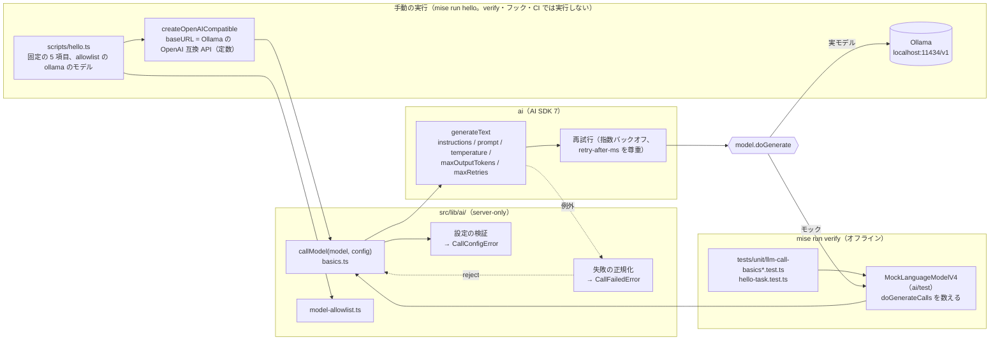
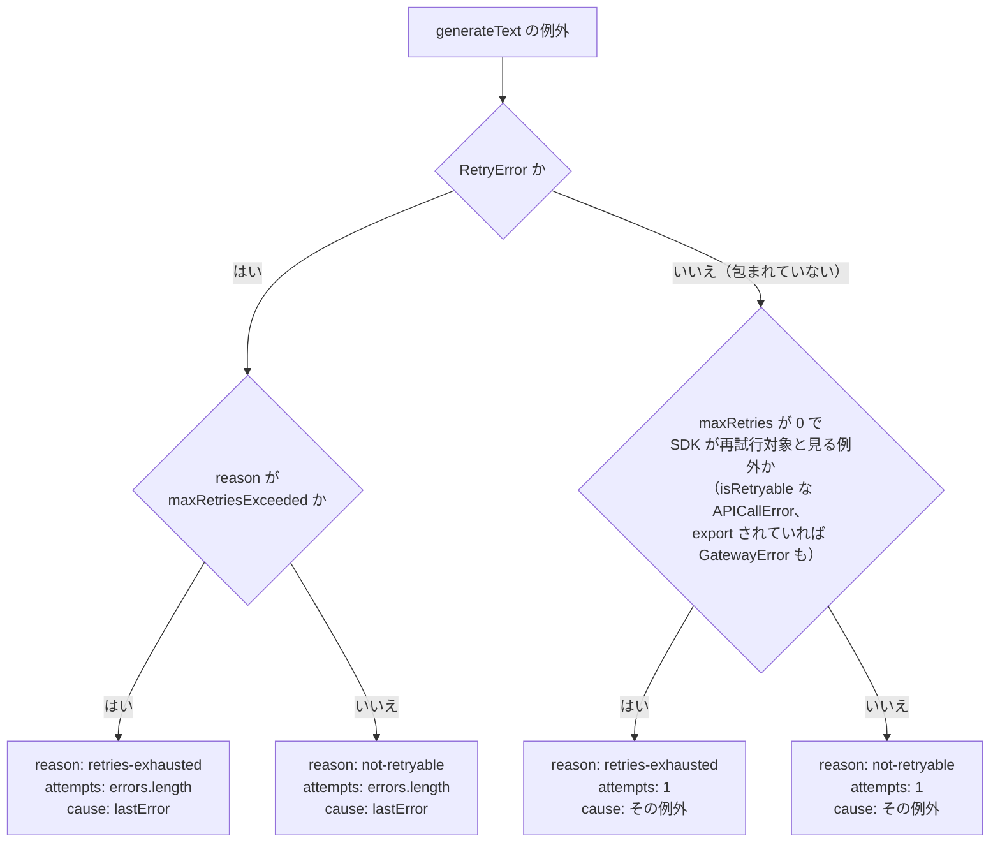
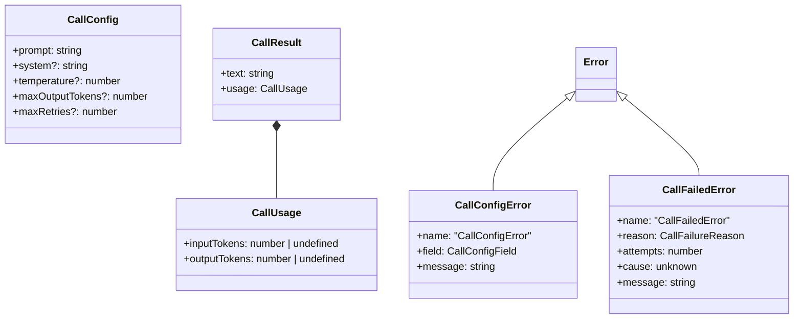

# 002-llm-call-basics — Technical Plan

承認済みの要件（WHAT）を設計（HOW）に落とす。実装コードは含まない（型の形と契約だけを示す）。根拠は
[research.md](research.md)（I-n は調査、ADR-n は設計判断、R-n は実装時の記録）。モデル ID は本書にも書かない
（憲章 原則 5）。

## Summary

`src/lib/ai/basics.ts` に、モデルを引数で受け取り `generateText` を 1 回呼ぶ呼び出し関数 `callModel` を置く。
関数は 5 項目の呼び出し設定を自前で検証し（ADR-4）、ラボの `system` を AI SDK の `instructions` に渡し（ADR-2）、
結果を `text` と 2 項目の `usage` だけの小さな値に変換し、SDK の失敗を判別しやすい `CallFailedError` に正規化する
（ADR-5）。再試行は SDK の `maxRetries` に任せ、既定は 2 回とする。

実 LLM の実行例 `scripts/hello.ts` は、Vercel 公式の `@ai-sdk/openai-compatible` で Ollama の OpenAI 互換 API を
呼ぶ（ADR-1）。Node の型の除去と `react-server` 条件で依存を足さずに動かし、Node で動かない書き方は
`tsconfig.json` の設定で `mise run typecheck` が止める（ADR-7）。合格判定は `ai/test` の `MockLanguageModelV4` だけで
オフラインに行い、再試行のテストは `retry-after-ms: "0"` で実時間の待ちをなくす（ADR-6）。

## Architecture Overview



- **呼び出しの流れ**: 呼び出し側（hello スクリプトまたはテスト）がモデルのオブジェクトを作って `callModel` に渡す。
  `callModel` は設定を検証し、不正なら `generateText` を呼ばずに `CallConfigError` で reject する。正しければ 5 項目
  だけを `generateText` に渡す（ツールなし、ストリーミングなし）。SDK は失敗した試行を再試行し、成功すれば
  `callModel` が `{ text, usage }` に変換して返す。失敗すれば SDK の例外を `CallFailedError` に包み直して reject する。
- **モデルの境界**: `callModel` はプロバイダのパッケージを import せず、文字列のモデル ID も受け取らない（ADR-3）。
  プロバイダとモデル ID を知っているのは hello スクリプトだけで、モデル ID は allowlist から取る。
- **サーバー専用の印**: `basics.ts` は先頭で `server-only` を import する。読み込み経路ごとの扱いは ADR-8 と I-9
  （hello は `--conditions=react-server`、Vitest は alias で空のモジュール、Next.js は何もしない）。

失敗の正規化（ADR-5、I-5）:



## Components

### C1 DependencyDeclaration (DES-2.1)

- **Responsibility**: 段 2 で加える第三者依存を、代替できない理由とともに宣言し、exact pin・24h ゲート・依存の権限の
  判断を設定に残す。
- **Public interface**:
  - **宣言する依存**（憲章 原則 10。この節が段 2 の宣言の正本で、根拠は research.md I-1・I-2・I-12、ADR-1・ADR-10）:

    | Package | 種別 | 理由（既存の依存・標準ライブラリで代替できない理由） |
    |---------|------|------------------------------------------------------|
    | `ai` | `dependencies` | `generateText`、再試行、`APICallError` / `RetryError`、`ai/test` のモックモデル。段 2 の学習対象そのもの |
    | `@ai-sdk/openai-compatible` | `dependencies` | hello スクリプトが Ollama の OpenAI 互換 API を呼ぶプロバイダ。公式の Ollama 専用パッケージはない（ADR-1） |
    | `server-only` | `dependencies` | 呼び出し関数のモジュールをサーバー専用にする印（憲章 原則 7）。Next.js と同じ仕組みを依存なしでは作れない |
    | `zod` | `dependencies` | `ai` と `@ai-sdk/openai-compatible` の必須の peer。自動で入る peer に版を任せず exact で固定する。段 2 のコードは import しない |
    | `@vitest/coverage-v8` | 計測専用（**`package.json` に入れない**） | NFR の分岐カバレッジの計測。使い捨ての worktree でだけ入れる（ADR-10） |

    - plan §2 の技術スタック表にない**新規の宣言**は `server-only` と `@vitest/coverage-v8`（計測専用）の 2 つ。
      `ai`・`@ai-sdk/openai-compatible` は同表の「AI（`ai`、各プロバイダ）」、`zod` は「検証 Zod 4.6」の行にあたる。
    - 入れない依存: `@ai-sdk/anthropic`・`@ai-sdk/openai`・`@ai-sdk/google`（8.4。解説の手順だけ）、`@ai-sdk/react`
      （段 3）、`tsx` などの TypeScript 実行器（ADR-7）、Ollama のコミュニティのプロバイダ（ADR-1）。
    - 版は実装時に 24h を満たす最新の安定版を確かめて exact で入れる（調査時の候補は research.md I-1。R-1 に記録）。
    - **install 直後の再確認**（tasks の最初のタスクの完了条件）: lockfile で確定した版の `node_modules/ai/docs/`、公開の
      `.d.ts`（`ai` と `ai/test`）、再試行の実装を読み、I-3〜I-7 の主張（`instructions`、`maxRetries`、`RetryError` の
      `reason`、`APICallError.isRetryable`、`retry-after-ms`、usage の形、`MockLanguageModelV4`、`GatewayError` の export）を
      確かめて R-1 に記録する。主張が変わっていたら、テストを書く前に plan を直す。
  - `package.json`: 上の 4 つを `dependencies` に exact 版で加える。`scripts` は変えない（検査は mise タスクに一本化）。
  - `pnpm-lock.yaml`: `pnpm install` で更新する。CI は `--frozen-lockfile`。
  - `pnpm-workspace.yaml`: `permissions` に `ai` の agent skill を拒否する設定（`skills: false`）を理由のコメントつきで
    加える（ADR-9、I-11）。`minimumReleaseAge` などの既存の設定は変えない。install スクリプトを持つ依存は加わらない
    （I-12）ので `allowBuilds` は変えない。
- **Owns**: 段 2 の依存の宣言と採用版、依存の権限の判断。
- **Does NOT own**: 依存を使うコード（C2、C3）、採用根拠と脆弱性検査の記録（research.md R-1）、`.env.example`（変更しない。
  8.7 は既存の `repo-policy.test.ts` が検査する）。
- **Requirements**: 8.1, 8.2, 8.3, 8.4

### C2 CallModel (DES-2.2)

- **Responsibility**: 渡されたモデルで `generateText` を 1 回（SDK の再試行を含む）呼び、設定の検証、結果の変換、
  失敗の正規化を行う。
- **Public interface**（`src/lib/ai/basics.ts`。型の詳細は Data Model と Interfaces）:
  - `callModel(model: ModelObject, config: CallConfig): Promise<CallResult>`
  - 型: `ModelObject`、`CallConfig`、`CallResult`、`CallUsage`、`CallConfigField`、`CallFailureReason`
  - 例外: `CallConfigError`、`CallFailedError`
  - 定数: `DEFAULT_MAX_RETRIES`（値は 2。4.5）
- **振る舞い**:
  1. モジュールの最初の文で `server-only` を import する（1.9）。import するのは `server-only` と `ai` だけ（1.1）。
  2. 設定を `prompt` → `temperature` → `maxOutputTokens` → `maxRetries` の順に検証し、最初に不正だった項目で
     `CallConfigError` を投げる（モデルは呼ばない。3.1〜3.5、ADR-4）。省略した項目は検証しない。
  3. `generateText` に `model`、`instructions: config.system`、`prompt`、`temperature`、`maxOutputTokens`、
     `maxRetries: config.maxRetries ?? DEFAULT_MAX_RETRIES` だけを渡す。`config` を展開（spread）して渡さない
     （余分なキーが SDK に届かない。1.2、1.8）。`tools`・`messages`・`abortSignal` は渡さない。
  4. 成功したら `{ text: result.text, usage: { inputTokens: result.usage.inputTokens, outputTokens: result.usage.outputTokens } }`
     を新しい object として返す。`text` は加工しない（2.1）。トークン数の `undefined` は `undefined` のまま（2.3）。
  5. `generateText` が投げた例外は、Architecture Overview の正規化の規則で `CallFailedError` にして投げる
     （4.2、4.3、4.4、4.6、4.7、4.8、ADR-5）。
- **Owns**: 呼び出し設定の検証規則、既定の再試行回数、結果の形、失敗の分類とメッセージ。
- **Does NOT own**: プロバイダとモデルの生成、モデル ID（呼び出し側と allowlist）。再試行の判定・間隔・回数の数え方
  （AI SDK）。表示や終了コード（C3）。ストリーミング、構造化出力、タイムアウト、ツール（段 3〜5）。
- **Requirements**: 1.1, 1.2, 1.4, 1.5, 1.6, 1.7, 1.8, 1.9, 2.1, 2.2, 2.3, 2.4, 2.5, 3.1, 3.2, 3.3, 3.4, 3.5,
  4.1, 4.2, 4.3, 4.4, 4.5, 4.6, 4.7, 4.8（1.3 は C2 の型と C4 の型検査で満たす）

### C3 HelloScript (DES-2.3)

- **Responsibility**: 手元の Ollama で allowlist の `ollama` のモデルを `callModel` 経由で 1 回呼び、応答と usage を表示する。
  呼べなければ、次に何をすればよいかを表示して終了コード 1 で終わる。
- **Public interface**:
  - `scripts/hello.ts`（引数を受け取らない。出力の契約は Interfaces の「hello スクリプト」）。
  - `mise.toml` のタスク `hello`: `node --conditions=react-server scripts/hello.ts` を実行する（5.8）。
- **構成**（上から順に読める 1 ファイル）:
  1. import: `@ai-sdk/openai-compatible` の `createOpenAICompatible`、`ai` の `APICallError`、
     `../src/lib/ai/basics.ts` の `callModel` と例外、`../src/lib/ai/model-allowlist.ts` の `MODEL_ALLOWLIST`
     （拡張子つき。ADR-7）。
  2. 定数: Ollama の OpenAI 互換 API の base URL（Ollama 公式の既定値。ADR-1）、モデル ID（`MODEL_ALLOWLIST.ollama` の
     先頭。5.2）、固定の `system` と `prompt`（引数を受け取らない。spec の前提）。
  3. **モデル生成の 1 行**: `const model = <provider>(<model ID>)`。解説の「プロバイダを変える方法」は、この行と対応する
     import を差し替える手順を示す（7.6）。
  4. `callModel` の呼び出しを 1 か所に置き、5 項目すべてに値を書く（5.3）。
  5. 成功時: 応答テキストと `inputTokens` / `outputTokens` を標準出力に書き、終了コード 0（5.1）。
  6. 失敗時: 例外を分類して標準エラーに案内を書き、`process.exitCode = 1`（5.4〜5.6）。分類は
     `CallFailedError` の `cause` が `APICallError` で `statusCode` がない → 接続できない（5.4）、`statusCode === 404` →
     モデル未取得（5.5）、それ以外 → 失敗の種類と概要（5.6）。判定に例外のメッセージの文字列を使わない（I-8）。
- **Owns**: Ollama の接続先の定数、表示の文面、終了コード。
- **Does NOT own**: 呼び出しと再試行（C2）、モデル ID の定義（allowlist）、環境変数による切り替え（段 6）。
  hello スクリプトの自動テスト（6.8 により持たない。動作は R-5 の実測で確かめる）。
- **Requirements**: 5.1, 5.2, 5.3, 5.4, 5.5, 5.6, 5.7, 5.8

### C4 TypeAndTestRuntimeConfig (DES-2.4)

- **Responsibility**: hello スクリプトの実行経路（Node の型の除去）とテストの実行経路（Vitest）で `basics.ts` が読めるように
  し、Node で動かない書き方を型検査で止める。
- **Public interface**:
  - `tsconfig.json`: `compilerOptions` に `allowImportingTsExtensions: true`、`verbatimModuleSyntax: true`、
    `erasableSyntaxOnly: true` を加え、`include` に `scripts/**/*.ts` を加える（ADR-7）。既存の設定は変えない
    （`isolatedModules: true` も残す）。
  - `vitest.config.ts`: `resolve.alias` に、`server-only` だけを `tests/unit/setup/server-only-stub.ts` に置き換える項目を
    加える（完全一致。`@` の alias、通信ガード、0 件レポーターなど既存の設定は変えない。ADR-8）。
  - `tests/unit/setup/server-only-stub.ts`: 何も export しない空のモジュール。役目をコメントで書く。
- **Owns**: 型検査の範囲と、Node の型の除去に合わせた制約。Vitest での `server-only` の扱い。
- **Does NOT own**: 1.9 の検査そのもの（C5 の契約テスト）、Next.js の設定（`next.config.ts` は変えない）。
- **Requirements**: 1.3, 1.9, 6.1, 6.4（いずれも C5 と組で満たす）

### C5 AcceptanceTests (DES-2.5)

- **Responsibility**: 段 2 の合格条件（出力、usage、再試行回数）と、型・読み込み条件・タスク構成の契約を、ネットワークも
  API キーもなしに決定論的に判定する。
- **Public interface**（テストファイルと、各ファイルが検証する要件）:
  - `tests/unit/llm-call-basics.test.ts`（振る舞い。`MockLanguageModelV4` だけを使う）:
    - このファイルの `describe` はすべて 1 件 1000 ms のタイムアウトを持つ（NFR、ADR-6。1 秒の制限はこのファイルの
      モックだけのテストに適用し、子プロセスや `mise` を起動するテストには適用しない。spec への追記 4、分析後の修正 M-2）。
    - 役割と設定（1.1、1.2、1.4〜1.8）: 渡したモックが生成要求を受けること、`doGenerateCalls[0].prompt` の役割の順序と
      本文、system 省略時は user 1 件、`temperature` / `maxOutputTokens` の値の受け渡しと省略時の `undefined`（1.7 の「含めない」は、モデルが受け取る
      生成要求の値が `undefined` であること。キーの有無は見ない。spec への追記 3）、
      `tools` が `undefined`・`doStreamCalls` が空・`doGenerateCalls` が 1 件。変数経由で余分なキーを持つ設定を渡しても
      余分なキーが生成要求に現れない（1.2）。
    - 結果（2.1〜2.5）: 前後の空白を含むテキストの一致、usage の一致、片方・両方が未報告のとき `undefined`（0 でない、
      キーは存在する）、結果と `usage` のキーが過不足なく 2 つずつで値が plain な値であること、再試行後の usage が
      成功した試行の値。
    - 設定値の拒否（3.1〜3.5）: 不正値の表（`""`、空白だけ（全角空白を含む）、`NaN`、`±Infinity`、`0`、`-1`、`1.5`）
      ごとに `CallConfigError`・`field` の値・`doGenerateCalls` が 0 件。境界の正しい値（`maxOutputTokens: 1`、
      `maxRetries: 0`、`temperature: 0`）は受け付ける。メッセージに prompt / system の本文（目印の文字列）が現れない。
    - 再試行とエラー（4.1〜4.8。ADR-6）: `maxRetries` ごとの「k 回失敗のあと成功」（試行 k + 1）、「使い切り」
      （試行 `maxRetries` + 1、`retries-exhausted`）、再試行しない例外（試行 1、`not-retryable`）、再試行可能 →
      再試行しない（試行 2、`not-retryable`。4.8）、再試行可能 → 再試行可能 → 再試行しない（許された最後の試行なので
      試行 3、`retries-exhausted`、`cause` は再試行しない例外。4.8）、`maxRetries: 0`（試行 1、`retries-exhausted`）、省略時（試行 3）、`cause` が最後の試行の例外と
      同一であること、SDK の例外のメッセージに目印の文字列を入れても `CallFailedError` のメッセージに現れないこと。
  - `tests/unit/llm-call-basics-contract.test.ts`（型と読み込みの契約）:
    - 型（1.2、1.3、ADR-3）: 余分なキー（`topP`、`instructions`、`abortSignal` など）を書いた object リテラルの行、
      `prompt` のない設定、文字列のモデル ID の直上に `// @ts-expect-error` を置く。指令が不要になると
      `mise run typecheck` が失敗する。各指令は 1 行に 1 つのキーだけを持つ行に付け、別の原因の型エラーを吸収しない。
      **実行するのは余分なキーの検査だけ**: 余分なキーを持つ設定を、変数で型を広げたうえで `MockLanguageModelV4` に
      渡して実行し、余分なキーが生成要求に現れないことを確かめる。**文字列のモデル ID の検査は実行しない**:
      文字列を渡す呼び出しは、呼ばない関数の本体（`const rejects = () => callModel("…", { prompt: "x" })`）に置き、
      `expect(typeof rejects).toBe("function")` で変数を使う（Biome の `noUnusedVariables` を満たし、`it.skip` を使わない）。
      実行すると SDK が AI Gateway のモデルを作りネットワークと鍵が要る（ADR-3）ため、オフラインの決定論に反する。
      文字列はモデル ID の形に見えないもの（`check:model-ids` が `tests/` を走査する）にする。
    - 境界（1.1）: `src/lib/ai/basics.ts` の import 元が `server-only` と `ai` だけであること。
    - サーバー専用の印（1.9、ADR-8）: 子プロセスの Node で `src/lib/ai/basics.ts` を import させ、既定の条件では
      非 0 で終わり出力に `server-only` を含むこと、`--conditions=react-server` では 0 で終わること。
  - `tests/unit/hello-task.test.ts`（5.3、5.7、5.8、5.9）: `mise` のタスク `hello` が 1 つのコマンド
    `node --conditions=react-server scripts/hello.ts` を持ち説明があること。`verify` と `security` から（参照をたどって）
    `hello` に届かないこと。`lefthook.yml` と `.github/workflows/` のどのファイルも `hello` のタスクとスクリプトを
    参照しないこと。あわせて `scripts/hello.ts` を**読むだけ**（import も実行もしない。6.8）の静的な検査を持つ:
    `process.env` と `import.meta.env` が現れないこと（5.7）、`callModel(` の呼び出しがちょうど 1 か所で、その引数に
    `system`・`prompt`・`temperature`・`maxOutputTokens`・`maxRetries` の 5 つが現れること（5.3）。5.6 の分類の分岐は
    レビューで確かめる。
  - `tests/unit/repo-policy.test.ts`（変更）: `pnpm-workspace.yaml` が `ai` の agent skill を拒否していること（ADR-9）。
  - テストの補助（成功の結果を作る関数、再試行可能な例外・再試行しない例外を作る関数、決めた順に失敗と成功を返すモック）は
    `llm-call-basics.test.ts` の中に置く（利用者が 1 ファイルだけのため。段 3 以降で共有が要れば `tests/unit/helpers/` へ移す）。
- **テストの規則**:
  - 実 LLM、Ollama、ネットワークに接続しない（6.1）。hello スクリプトを import も実行もしない（6.8。ソースの読み取りは
    `hello-task.test.ts` の静的な検査に限って行う）。文字列のモデル ID の呼び出しも実行しない（ADR-3）。
  - 試行回数は `doGenerateCalls.length` で数える（6.2）。
  - 再試行可能な例外は `retry-after-ms: "0"` を持ち、実時間を待たない（ADR-6）。
  - テストの文字列にモデル ID の形の文字列を書かない（`check:model-ids` が `tests/` を走査する）。
  - 各テストは実装より先に追加して失敗を確かめ（R-2）、実装を壊して失敗することを確かめる（R-3）（6.6、6.7）。
- **Owns**: 段 2 の合格判定とその記録の置き場。
- **Does NOT own**: 解説の構造の検査（既存の `docs-structure.test.ts` が全解説に適用する）、モデル ID の検査（既存の
  `check:model-ids`）、未モック通信の遮断（既存の `tests/unit/setup/network-guard.ts`）。
- **Requirements**: 6.1, 6.2, 6.3, 6.4, 6.5, 6.6, 6.7, 6.8, 5.8, 5.9（および C2 の全要件の検証）

### C6 StageGuide (DES-2.6)

- **Responsibility**: 段 2 を「読む → 動かす → 改造する → テストで合格を確かめる」で進める解説と、プロバイダを変える手順を
  示す。
- **Public interface**（`docs/stages/2-llm-call-basics.md` の `##` 見出し、この順）:
  1. `読む`: `generateText`、system / user の役割（ラボの `system` が SDK の `instructions` に当たること。ADR-2）、
     `temperature`、`maxOutputTokens`、usage（未報告は `undefined`）、エラーと再試行（`maxRetries`、既定 2、
     `retries-exhausted` / `not-retryable`。`retries-exhausted` は最後の失敗の種類によらず「許された試行を使い切った」
     意味で、再試行可能・再試行可能・再試行しない例外の順に失敗した場合もこれになり、`cause` は再試行しない例外である
     ことも説明する）の 6 つを、`src/lib/ai/basics.ts` の該当箇所（関数・型の名前）と対応づけて
     説明する（7.2）。モデルを引数で受け取る理由（テストでモックに差し替える）もここで触れる。
  2. `動かす`: Ollama の導入と起動 → allowlist の `ollama` のモデルの取得（`ollama pull` に渡す ID は
     `src/lib/ai/model-allowlist.ts` を見る。`mise run hello` が未取得時に正確なコマンドを表示する）→ `mise run hello` →
     成功時の表示（応答テキストと usage）の順（7.3）。
  3. `改造する`: 1 つ以上の課題（7.4）。例: `temperature` を変えて応答の揺れを見る、`maxOutputTokens` を小さくして
     `outputTokens` と途中で切れる応答を見る、`maxRetries: 0` にして Ollama 未起動時の終了が速くなることを見る、
     `maxOutputTokens: 0` にして `CallConfigError` を見る。テスト側の課題（`DEFAULT_MAX_RETRIES` を変えて 4.5 のテストが
     落ちることを見る）も 1 つ置く。
  4. `テストで合格を確かめる`: 合格条件（出力、usage、再試行の回数）ごとにテストのパス
     （`tests/unit/llm-call-basics.test.ts` など）と、`mise run test` / `mise run verify` を示す（7.5）。
  5. `プロバイダを変える方法`: Anthropic、OpenAI、Google のそれぞれについて、(1) 入れるパッケージ
     （`@ai-sdk/anthropic`、`@ai-sdk/openai`、`@ai-sdk/google`）と、先に plan を改正すること（憲章 原則 10）、
     (2) hello スクリプトで差し替えるモデル生成の 1 行と import、(3) API キーの環境変数名（`.env.example` の
     `ANTHROPIC_API_KEY`・`OPENAI_API_KEY`・`GOOGLE_GENERATIVE_AI_API_KEY`）、(4) モデル ID は allowlist の該当
     プロバイダのものに限ること、を示す（7.6）。段 2 の時点ではパッケージが入っておらず実行できないことと、
     環境変数による切り替え（`AI_PROVIDER`、`OLLAMA_BASE_URL` を含む）は段 6 で扱うことを明記する（7.7）。
  6. `この段で扱わないこと`: ストリーミング（段 3）、構造化出力（段 4）、タイムアウトと中断（段 5）、自作の再試行
     （`from-genai-to-agentic-ai` の該当モジュールへのリンク）。段 3〜5 は全体計画 §5 の表へリンクする（7.9）。
- **書き方の規則**: モデル ID の文字列を書かない（7.8。`check:model-ids` が `docs/` を走査する）。版番号を書くときは
  確認日つきの参考値にする。兄弟リポジトリの本文を写さない。
- **Owns**: 段 2 の解説。
- **Does NOT own**: 解説の構造の検査（既存の `docs-structure.test.ts`）、コード（C2、C3）。
- **Requirements**: 7.1, 7.2, 7.3, 7.4, 7.5, 7.6, 7.7, 7.8, 7.9

### C7 GovernanceSync (DES-2.7)

- **Responsibility**: 段 2 で入った依存・ファイル・コマンドに、エージェント向けの文書と steering と根拠の記録を合わせる。
- **Public interface**:
  - `AGENTS.md`（英語）: "Current state" を段 2 の状態に、コマンド表に `mise run hello`（Ollama が要り、verify に
    含まれないこと）を加え、Architecture の `src/` の記述に `src/lib/ai/basics.ts` と `scripts/hello.ts` を加える（8.8）。
    あわせて Code rules に 2 行を加える: Node が直接実行するコード（`scripts/*.ts` とそれが import するもの）は消せる構文と
    `import type` に限り `tsconfig.json` が守らせること、AI SDK の API は `node_modules/ai/docs/` の同梱文書で確かめること
    （ADR-7、ADR-9）。
  - `.sdd/steering/tech.md`: 状態の注記、Stack の AI の行（`ai`、Ollama 用の `@ai-sdk/openai-compatible`、`server-only`、
    peer の `zod`）、Conventions（`system` ではなく `instructions`、Node の型の除去と `react-server` 条件で動かすスクリプト、
    dependency の agent skill を承認しないこと）を更新する（8.9）。
  - `.sdd/steering/structure.md`: 状態の注記、Directory Map の `scripts/`（`hello.ts`）と `tests/unit/setup/`
    （`server-only-stub.ts`）を更新する（8.9）。
  - `README.md`: コマンド表に `mise run hello` の行を加える。
  - `specs/002-llm-call-basics/spec.md`: Clarifications に plan 時の追記を加える（Ollama の接続先の定数の解釈、
    「不明」の表示の文言、1.7 の「含めない」の解釈、NFR 1 秒の範囲。本 plan の「spec への追記」1〜4）。
  - `specs/002-llm-call-basics/research.md`: 実装時の記録 R-1〜R-7 を追記する（8.5、6.6、6.7、NFR）。
- **Owns**: 文書と実物の一致。
- **Does NOT own**: 憲章の改正（段 2 は不要。TODO(BRANCH_COVERAGE) の決定は R-6 を入力にした別の改正で行う）、
  全体計画 spec 000 の改訂（本 plan の宣言で原則 10 を満たすため不要）。
- **Requirements**: 8.5, 8.8, 8.9

### spec への追記（plan 時、2026-11-27）

spec の前提は「plan で覆す場合は Clarifications に記録する」と定める。次の 4 点を spec.md の Clarifications に記録する。

1. **Ollama の接続先**: 「Ollama プロバイダの既定のローカルアドレス」は、`@ai-sdk/openai-compatible` が既定の接続先を
   持たないため、Ollama の公式文書が示すローカルの OpenAI 互換 API の base URL を hello スクリプトの定数として書くことで
   満たす（ADR-1）。環境変数を読まない点は変えない。
2. **「不明」の表示**: hello スクリプトの出力の文面はコードの言語の規則（英語）に合わせ、報告されなかったトークン数は
   `unknown` と表示する。意味（0 で埋めず、未報告であることを示す）は変えない。
3. **1.7 の「含めない」**: 省略した `temperature` / `maxOutputTokens` は、モデルが受け取る生成要求の値が `undefined` で
   あることをもって「含めない」を満たす。生成要求は SDK が組み立てるため、キー自体の有無はラボ側では保証できず、
   テストもキーの有無を見ない（plan 検証時、2026-11-27、Codex の指摘への判断）。
4. **NFR「1 件あたり 1 秒以内」の範囲**: モックだけを使う `llm-call-basics.test.ts` の各テストに適用する。子プロセスを
   起動する契約テストと、`mise` を呼ぶテストは既存の慣例（120 秒のタイムアウト）に従い、1 秒の対象にしない。

## Data Model

永続化するデータはない。`src/lib/ai/basics.ts` が公開する値の型だけを定める（すべて `readonly`）。



| Entity | Field | Type | Notes |
|--------|-------|------|-------|
| `CallConfig` | `prompt` | `string` | 必須。空白以外の文字を 1 つ以上含む（3.1）。user 役割のメッセージになる（1.4） |
| | `system` | `string \| undefined` | 省略可。SDK の `instructions` に渡り、system 役割のメッセージになる（1.4、1.5、ADR-2）。検証しない |
| | `temperature` | `number \| undefined` | 省略可。有限の数（3.2）。省略時は生成要求に含めない（1.7） |
| | `maxOutputTokens` | `number \| undefined` | 省略可。1 以上の整数（3.3）。省略時は生成要求に含めない（1.7） |
| | `maxRetries` | `number \| undefined` | 省略可。0 以上の整数（3.4）。省略時は `DEFAULT_MAX_RETRIES`（2）（4.5） |
| `CallResult` | `text` | `string` | モデルが生成したテキストをそのまま（2.1） |
| | `usage` | `CallUsage` | 成功した試行の値（2.5） |
| `CallUsage` | `inputTokens` | `number \| undefined` | 未報告は `undefined`。キーは常にある（2.2、2.3）。`?:` の省略可能な形にしない |
| | `outputTokens` | `number \| undefined` | 同上 |
| `CallConfigError` | `field` | `CallConfigField` | `"prompt" \| "temperature" \| "maxOutputTokens" \| "maxRetries"`。最初に不正だった項目（3.5） |
| | `message` | `string` | 項目名と満たすべき条件だけ。値・prompt・system を含めない（3.5） |
| `CallFailedError` | `reason` | `CallFailureReason` | `"retries-exhausted" \| "not-retryable"`（4.6。規則は ADR-5） |
| | `attempts` | `number` | SDK が報告した試行回数（`RetryError.errors.length`、包まれていない例外は 1） |
| | `cause` | `unknown` | 最後の試行の例外をそのまま（4.6）。ES2022 の `Error` の `cause` を使い、クラスのフィールドとして宣言し直さない（宣言し直すと `super` が設定した値を `undefined` で上書きする） |
| | `message` | `string` | `reason` と `attempts` だけから作る。`cause` のメッセージ・prompt・system を含めない（4.7） |

`ModelObject` は `Exclude<LanguageModel, string>`（ADR-3）。結果と例外は AI SDK のクラスや型の値を持たない。ただし
`CallFailedError.cause` は最後の試行の失敗原因そのもの（多くは SDK の `APICallError`）で、4.6 が持つことを求める。

## Interfaces / Contracts

### `src/lib/ai/basics.ts`（型と契約。実装は含まない）

公開する名前を `.d.ts` と同じ宣言の形で示す（本体は実装で書く）。

```ts
// The only imports of this module (1.1, 1.9).
import "server-only";
import { type LanguageModel /* , generateText, APICallError, RetryError */ } from "ai";

export type ModelObject = Exclude<LanguageModel, string>;

export interface CallConfig {
  readonly prompt: string;
  readonly system?: string;
  readonly temperature?: number;
  readonly maxOutputTokens?: number;
  readonly maxRetries?: number;
}

export interface CallUsage {
  readonly inputTokens: number | undefined;
  readonly outputTokens: number | undefined;
}

export interface CallResult {
  readonly text: string;
  readonly usage: CallUsage;
}

export type CallConfigField = "prompt" | "temperature" | "maxOutputTokens" | "maxRetries";
export type CallFailureReason = "retries-exhausted" | "not-retryable";

export const DEFAULT_MAX_RETRIES: number; // 2

export class CallConfigError extends Error {
  readonly field: CallConfigField;
}

export class CallFailedError extends Error {
  readonly reason: CallFailureReason;
  readonly attempts: number;
  // `cause: unknown` is inherited from Error (set through `super(message, { cause })`).
}

export function callModel(model: ModelObject, config: CallConfig): Promise<CallResult>;
```

- `callModel` は reject だけで失敗を伝え、同期的に throw しない（`async` 関数）。
- 例外のクラスはどちらも `name` をクラス名にする（hello スクリプトとテストが `instanceof` と `name` のどちらでも判別できる）。
- メッセージの文面は英語（例: `CallConfigError`: 「`maxOutputTokens` must be an integer of 1 or more」の形。
  `CallFailedError`: 「The model call failed after 3 attempts: retries exhausted」の形）。テストは文面を固定せず、
  `field` / `reason` / `attempts` と「本文の目印を含まないこと」で判定する。

### `generateText` へ渡すもの（1.2〜1.8、ADR-2）

| ラボの設定 | `generateText` の引数 | モデルへの生成要求（モックの `doGenerateCalls[n]`） |
|------------|------------------------|------------------------------------------------------|
| （引数）`model` | `model` | 渡したモデルの `doGenerate` が呼ばれる |
| `system` | `instructions` | `prompt[0]` が `{ role: "system", content }`。省略時は system のメッセージなし |
| `prompt` | `prompt` | system の次（省略時は先頭）が `{ role: "user", content: [{ type: "text", text }] }` |
| `temperature` | `temperature` | `temperature`（省略時は `undefined`） |
| `maxOutputTokens` | `maxOutputTokens` | `maxOutputTokens`（省略時は `undefined`） |
| `maxRetries` | `maxRetries`（省略時は 2） | 試行回数の上限 = `maxRetries` + 1 |
| — | 渡さない（`tools`、`messages`、`abortSignal`、`output` など） | `tools` は `undefined`。`doStream` は呼ばれない |

### hello スクリプト（`scripts/hello.ts`、`mise run hello`）

| 状況 | 標準出力 | 標準エラー | 終了コード | 要件 |
|------|----------|------------|------------|------|
| 成功 | 使ったモデル ID（allowlist から）、応答テキスト、`inputTokens` / `outputTokens`（未報告は `unknown`） | なし | 0 | 5.1 |
| Ollama に接続できない（`cause` が `statusCode` のない `APICallError`） | なし | 接続できないこと、Ollama の起動方法（アプリを起動するか `ollama serve`）、`ollama pull <allowlist の ID>` | 1 | 5.4 |
| モデルが未取得（`cause` が `statusCode === 404` の `APICallError`） | なし | モデルが未取得であること、`ollama pull <allowlist の ID>` | 1 | 5.5 |
| それ以外の失敗 | なし | 失敗の種類（`CallFailedError` なら `reason` と `attempts`、`CallConfigError` なら `field`、それ以外は例外の `name`）と概要（`cause` の `name` と、あれば HTTP の状態コード） | 1 | 5.6 |

- `prompt` と `system` の本文、例外の `cause` の丸ごと（`requestBodyValues` を含む）、例外のメッセージの中身は出力しない
  （5.7、ADR-5）。`console.error(error)` のように例外を丸ごと出力しない。
- 環境変数を読まない（API キーも `OLLAMA_BASE_URL` も）。`@ai-sdk/openai-compatible` は `apiKey` を渡さない限り環境変数を
  読まない（I-8）。
- 未起動時は `maxRetries` 回の再試行（既定の値で約 6 秒、I-8）のあとに案内を出す。NFR の 15 秒以内を R-5 で実測する。

### mise タスク（`mise.toml`）

| Task | Run | 説明（description）の要点 | 呼ぶもの |
|------|-----|---------------------------|----------|
| `hello` | `node --conditions=react-server scripts/hello.ts` | 手元の Ollama のモデルを 1 回呼び、応答と usage を表示する。Ollama が要る。verify に含まれない | 手動の実行だけ。`verify`、`security`、lefthook、CI から呼ばない（5.9） |

`verify` と `security` の構成は変えない。

### 設定ファイル

| File | 追加する設定 | 目的 |
|------|--------------|------|
| `tsconfig.json` | `allowImportingTsExtensions: true`、`verbatimModuleSyntax: true`、`erasableSyntaxOnly: true`、`include` に `scripts/**/*.ts` | hello と、hello が読む `src/lib/ai/*.ts` を Node の型の除去で動く形に保ち、型検査する（ADR-7） |
| `vitest.config.ts` | `resolve.alias` に `server-only` → `tests/unit/setup/server-only-stub.ts`（完全一致） | Vitest で `basics.ts` を読めるようにする（ADR-8） |
| `pnpm-workspace.yaml` | `permissions: { ai: { skills: false } }`（理由のコメントつき） | `ai` の agent skill を承認しない判断を記録する（ADR-9） |

## File Structure Plan

tasks.md の `_Boundary:_` は、この表のファイルだけを対象にできる。

| File | Create/Modify | Responsibility |
|------|---------------|----------------|
| `package.json` | Modify | C1 の 4 依存（`ai`、`@ai-sdk/openai-compatible`、`server-only`、`zod`）を `dependencies` に exact 版で加える |
| `pnpm-lock.yaml` | Modify | 段 2 の依存を加えた依存グラフを固定する |
| `pnpm-workspace.yaml` | Modify | `ai` の agent skill を承認しない判断（`permissions`）を理由のコメントつきで記録する |
| `tsconfig.json` | Modify | `.ts` 拡張子の import、`verbatimModuleSyntax`、`erasableSyntaxOnly` を有効にし、`scripts/**/*.ts` を型検査に含める |
| `vitest.config.ts` | Modify | `server-only` だけを空のモジュールに置き換える alias を加える |
| `mise.toml` | Modify | 手動で実行する `hello` タスク（`node --conditions=react-server scripts/hello.ts`）を加える |
| `src/lib/ai/basics.ts` | Create | 呼び出し関数 `callModel`、呼び出し設定・結果の型、2 つの例外クラス、既定の再試行回数を定義する |
| `scripts/hello.ts` | Create | allowlist の `ollama` のモデルを Ollama の OpenAI 互換 API で 1 回呼び、応答と usage、または次の手順を表示する |
| `tests/unit/setup/server-only-stub.ts` | Create | Vitest で `server-only` の代わりに読まれる空のモジュール |
| `tests/unit/llm-call-basics.test.ts` | Create | モックモデルで、役割・設定の受け渡し、結果と usage、設定値の拒否、再試行と例外を検証する |
| `tests/unit/llm-call-basics-contract.test.ts` | Create | 呼び出し設定とモデルの型の契約、`basics.ts` の import 元、`server-only` の読み込み条件を検証する |
| `tests/unit/hello-task.test.ts` | Create | `hello` タスクの形と、verify・security・フック・CI が hello を実行しないことを検証する |
| `tests/unit/repo-policy.test.ts` | Modify | `ai` の agent skill を拒否する設定が残っていることを検証するテストを加える |
| `docs/stages/2-llm-call-basics.md` | Create | 段 2 の解説（4 節、プロバイダを変える方法、この段で扱わないこと） |
| `AGENTS.md` | Modify | Current state、コマンド表（`hello`）、Architecture の `src/`、Code rules（Node が実行するコードの制約、同梱文書）を段 2 に合わせる |
| `README.md` | Modify | コマンド表に `mise run hello` を加える |
| `.sdd/steering/tech.md` | Modify | 状態の注記、AI の依存、`instructions`・Node で動かすスクリプト・agent skill の規約を段 2 に合わせる |
| `.sdd/steering/structure.md` | Modify | 状態の注記、`scripts/hello.ts` と `tests/unit/setup/server-only-stub.ts` の置き場を段 2 に合わせる |
| `specs/002-llm-call-basics/spec.md` | Modify | Clarifications に plan 時の追記（Ollama の接続先の定数、`unknown` の表示、1.7 の「含めない」、NFR 1 秒の範囲）を加える |
| `specs/002-llm-call-basics/research.md` | Modify | 実装時の記録 R-1〜R-7（版、RED、非空虚、verify、hello の実測、カバレッジ、権限）を追記する |
| `specs/002-llm-call-basics/spec.json` | Modify | フェーズと承認の状態を更新する |

変更しないファイル（確認済み）: `.env.example`（変数名だけで 8.7 を満たし、7.6 が参照する 3 つの API キー名を持つ）、
`next.config.ts`、`lefthook.yml`、`.github/workflows/*`、`scripts/check-model-ids.mjs`、`tests/unit/docs-structure.test.ts`
（段 2 の解説にもそのまま適用される）、`src/lib/ai/model-allowlist.ts`。

**実装順の制約**（憲章 原則 4）: 合格判定テストが import できるよう、テストより先に置くのは依存（`package.json`、
`pnpm-lock.yaml`、`pnpm-workspace.yaml`）と実行設定（`tsconfig.json`、`vitest.config.ts`、`server-only-stub.ts`）だけに限る。
この時点で `src/lib/ai/basics.ts` は存在しないため、テストは import の失敗で RED になる（R-2 に記録）。`mise.toml` の
`hello` タスクは `hello-task.test.ts` の RED のあとに加え、`scripts/hello.ts` は C2 の GREEN のあとに書く（自動テストを
持たないため、R-5 の実測で確かめる）。

## Error Handling & Edge Cases

呼び出し関数（C2）:

- `prompt` が `""`、空白だけ（`\n`、`\t`、全角空白を含む）→ `CallConfigError`（`field: "prompt"`）、モデルは呼ばない（3.1）
- `temperature` が `NaN`、`Infinity`、`-Infinity` → `CallConfigError`（`field: "temperature"`）（3.2）。有限なら負の値も
  受け付け、範囲の判断はモデルに任せる
- `maxOutputTokens` が `0`、負の数、小数、`NaN`、`Infinity` → `CallConfigError`（`field: "maxOutputTokens"`）（3.3）
- `maxRetries` が負の数、小数、`NaN`、`Infinity` → `CallConfigError`（`field: "maxRetries"`）（3.4）
- 複数の項目が不正 → 検証の順（`prompt` → `temperature` → `maxOutputTokens` → `maxRetries`）で最初の項目を `field` にする（3.5）
- `system` が `""` → 検証せずそのまま渡す。空の system メッセージになる（I-6。spec に規則がないため加えない）
- 型を広げた変数で余分なキーを渡す → 5 項目だけを取り出して渡すため、余分なキーは SDK に届かない（1.2）
- 再試行可能な例外が `maxRetries` 回以内で止み成功 → 成功の結果。試行 = 失敗回数 + 1（4.1）。usage は成功した試行の値（2.5）
- 再試行可能な例外が続く → 試行 `maxRetries` + 1 回で `CallFailedError`（`retries-exhausted`）（4.2）
- 1 回目が再試行しない例外（認証の失敗 401、不正な要求 400 など、`APICallError` 以外の例外を含む）→ 試行 1 回で
  `CallFailedError`（`not-retryable`）（4.3）
- 再試行のあと再試行しない例外 → その時点で止まり `CallFailedError`（`not-retryable`）。ただしそれが許された最後の試行なら
  SDK に合わせて `retries-exhausted`（4.8、I-5、ADR-5）
- `maxRetries: 0` で再試行可能な例外 → SDK は包まずに投げる。試行 1 回で `CallFailedError`（`retries-exhausted`）（4.4）
- `maxRetries` 省略 → 上限 2 回、試行は最大 3 回（4.5）
- SDK の例外のメッセージが prompt / system を含む → `CallFailedError` のメッセージに写さない（4.7）
- モデルが usage の一方・両方を報告しない → `undefined` で返す（2.3）。合計（`totalTokens`）は返さない（2.4）
- 応答が空のテキスト → `""` をそのまま返す（2.1。エラーにしない）

hello スクリプト（C3）:

- Ollama が起動していない → 再試行（約 6 秒）のあと、起動方法と `ollama pull` を標準エラーに出し終了コード 1（5.4）
- Ollama は起動しているがモデルが未取得 → 404 を受けてすぐに `ollama pull` を出し終了コード 1（5.5、I-8 で 60 ms）
- それ以外（Ollama の 500、改造で入れた不正な設定値など）→ 種類と概要を出し終了コード 1（5.6）
- 例外の表示で `cause` を丸ごと出さない（`APICallError.requestBodyValues` に prompt が入る。5.7、ADR-5）
- Node の既定の条件で直接実行した（`node scripts/hello.ts`）→ `server-only` が例外を投げる。解説は `mise run hello` を使うよう
  案内する（I-9）

設定とテスト（C4、C5）:

- `react-server` 条件を持たない経路（Vitest）で `server-only` を読む → alias の空のモジュールに置き換わる（ADR-8）
- 型だけの import に `type` がない、消せない構文を書いた → `mise run typecheck` が `TS1484` / `TS1294` で失敗する（ADR-7）
- SDK が `retry-after-ms` を読まなくなった → 再試行のテストが 1000 ms のタイムアウトで失敗する（ADR-6）。原因を調べ、
  テストを緩めない（憲章 原則 4）
- `@ts-expect-error` の指令が別の原因の型エラーを吸収する → 指令は余分なキー 1 つだけを持つ行の直上に置き、R-3 で
  「型を広げると指令が不要になって `tsc` が失敗する」ことを確かめる

## Constitution Compliance

対象: `.sdd/memory/constitution.md` 1.1.0。

| Principle | Status | Notes |
|-----------|--------|-------|
| 1. 入門ラボの範囲を守る | ✅ | 扱うのは `generateText` の 1 回の呼び出しだけ。ストリーミング・構造化出力・ツール・自作の再試行は段 3〜5 と卒業先へのリンクに回す（C6）。兄弟リポジトリの本文・コードを写さない |
| 2. spec・解説・実装・合格テストで完成 | ✅ | `specs/002-llm-call-basics/`、`docs/stages/2-llm-call-basics.md`、`src/lib/ai/basics.ts` と `scripts/hello.ts`、`tests/unit/llm-call-basics*.test.ts` ほか。解説の 4 節と参照パスの実在は既存の `docs-structure.test.ts` が検査する |
| 3. ゲートは 1 つ・決定論・空振りしない | ✅ | `verify` と `security` の構成は変えない。新しいテストはモックと `node` の子プロセスだけを使い、ネットワークに触れない。再試行のテストは実時間を待たない（ADR-6）。hello は verify・フック・CI で実行しない（`hello-task.test.ts`）。非空虚は R-3 に記録する |
| 4. テストを先に書く | ⚠️ | (a) 依存と実行設定（C1、C4）は最初の RED より前に要る。File Structure Plan の「実装順の制約」で範囲を限り、tasks.md で順序を明示すること。(b) `scripts/hello.ts` は spec（Clarifications 5 問目、6.8）により自動テストを持たない。`hello` タスクの形は `hello-task.test.ts` を先に書いて守り、振る舞いは R-5 の実測（成功・未起動・未取得）で確かめる。どちらも spec の決定の範囲内で、CRITICAL ではない |
| 5. モデルは注入し、ID は allowlist だけ | ✅ | `callModel` はモデルのオブジェクトを引数で受け、文字列のモデル ID を型で拒否する（ADR-3）。テストは `MockLanguageModelV4` だけ。hello はモデル ID を `MODEL_ALLOWLIST.ollama` から取る。`check:model-ids` が `src/`・`scripts/`・`tests/`・`docs/` を走査する。`Output.object` / `generateObject` は段 2 で使わない |
| 6. エージェントは止まり、承認を待つ | N/A | 段 5 の範囲。段 2 はツールを渡さない（1.8） |
| 7. 型と境界を固定する | ✅ | `strict`、`any` なし、型アサーションなし。失敗原因は `unknown` で持つ。`basics.ts` は `server-only`（1.9、ADR-8）。段 2 にはシステム境界（HTTP、環境変数、ツール入力、構造化出力）がなく Zod を使わない。設定値の検証（ADR-4）は型で表せない値の範囲を spec 3 章どおり 1 回だけ調べるもので、検証済みの値の再検証ではない |
| 8. 秘密情報とサプライチェーン | ✅ | API キーを読まない（hello は環境変数を読まず、プロバイダも `apiKey` なしで環境変数を読まない。I-8）。prompt・system・`cause` の丸ごとを出力しない（4.7、5.7）。依存は exact pin、24h ゲート（除外なし）、install スクリプトなし（I-12）、agent skill を拒否（ADR-9）。`mise run security` を実装時に通す（R-1） |
| 9. 事実は実測、版は現時点の採用版 | ✅ | API・既定値・例外・Ollama の挙動は、同梱文書・型定義・ソース・実行で確認した（research.md I-1〜I-12）。テストと文書は版番号を合否に使わない |
| 10. 依存は plan に宣言してから | ✅ | 依存は C1 の表に限り、理由を添える。`@vitest/coverage-v8` も計測専用として宣言する（ADR-10）。Ollama は手動の実行でだけ使うローカルのサービスで、API キーが要らず、テストはモックの経路を持つ。新しい CI ジョブはない |
| 11. 段階ゲートを飛ばさない | ✅ | 段 1 は `main` に統合済み（PR #2）。今回の `-y` は承認済みの要件を確認しただけ。設計とタスクは人間が承認する。実装フェーズごとに別モデルファミリー（Codex）の敵対的レビューを `.sdd/reviews/` に 1 ラウンド 1 ファイルで残す |
| Additional Constraints: ツールチェーン | ✅ | `hello` は mise タスク。`node` は mise 管理の版 |
| Additional Constraints: Node のレーン | ✅ | 契約テストの子プロセス（型の除去と `--conditions`）は Node 27 のレーンの `verify` でも走り、結果は参考扱い。Node 27 でだけ必要な修正が出たら `docs/node27/` に記録する |
| Additional Constraints: lint / format・テストのモック | ✅ | Biome 単一。unit は `ai/test` のモックモデル。E2E は変えない |
| Additional Constraints: UI | N/A | 段 2 は UI を持たない（shadcn/ui と Tailwind CSS v4 は段 3。spec の Out of Scope） |
| Additional Constraints: 品質目標 | ✅ | 分岐カバレッジは計測して R-6 に記録するだけで、しきい値（TODO(BRANCH_COVERAGE)）は合否に使わない |
| Additional Constraints: 言語 | ✅ | 解説・steering・spec は日本語、コード・識別子・`AGENTS.md`・hello の出力の文面は英語（spec への追記 2） |

CRITICAL な違反はない。⚠️ の 1 件（原則 4 の順序）は、tasks.md で実装順を明示し、R-2・R-5 に記録して解消する。

## Requirements Traceability

検証欄の `R-n` は research.md の実装時の記録、「レビュー」は `/sdd-validate-impl` と敵対的レビューでの確認を表す。
テストのパスは `tests/unit/` を省略して書く。

| Requirement ID | Component(s) | 検証 |
|----------------|--------------|------|
| 1.1 | C2 | `llm-call-basics.test.ts`（渡したモックが呼ばれる）、`llm-call-basics-contract.test.ts`（import 元、文字列のモデル ID の型エラー） |
| 1.2 | C2 | `llm-call-basics-contract.test.ts`（`prompt` なしの型エラー）、`llm-call-basics.test.ts`（余分なキーが届かない） |
| 1.3 | C2, C4, C5 | `llm-call-basics-contract.test.ts` の `@ts-expect-error` を `mise run typecheck` が検査、R-3 |
| 1.4 | C2 | `llm-call-basics.test.ts` |
| 1.5 | C2 | `llm-call-basics.test.ts` |
| 1.6 | C2 | `llm-call-basics.test.ts` |
| 1.7 | C2 | `llm-call-basics.test.ts` |
| 1.8 | C2 | `llm-call-basics.test.ts` |
| 1.9 | C2, C4, C5 | `llm-call-basics-contract.test.ts`（子プロセスの Node で既定 / `react-server` の条件） |
| 2.1 | C2 | `llm-call-basics.test.ts` |
| 2.2 | C2 | `llm-call-basics.test.ts` |
| 2.3 | C2 | `llm-call-basics.test.ts` |
| 2.4 | C2 | `llm-call-basics.test.ts` |
| 2.5 | C2 | `llm-call-basics.test.ts` |
| 3.1 | C2 | `llm-call-basics.test.ts` |
| 3.2 | C2 | `llm-call-basics.test.ts` |
| 3.3 | C2 | `llm-call-basics.test.ts` |
| 3.4 | C2 | `llm-call-basics.test.ts` |
| 3.5 | C2 | `llm-call-basics.test.ts` |
| 4.1 | C2 | `llm-call-basics.test.ts` |
| 4.2 | C2 | `llm-call-basics.test.ts` |
| 4.3 | C2 | `llm-call-basics.test.ts` |
| 4.4 | C2 | `llm-call-basics.test.ts` |
| 4.5 | C2 | `llm-call-basics.test.ts` |
| 4.6 | C2 | `llm-call-basics.test.ts` |
| 4.7 | C2 | `llm-call-basics.test.ts` |
| 4.8 | C2 | `llm-call-basics.test.ts` |
| 5.1 | C3 | R-5（成功時の表示と終了コード 0） |
| 5.2 | C3 | `check:model-ids`（`scripts/` を走査）、レビュー |
| 5.3 | C3, C5 | `hello-task.test.ts`（`scripts/hello.ts` を読むだけの静的な検査）、レビュー |
| 5.4 | C3 | R-5（未起動時の表示、終了コード 1、開始からの秒数） |
| 5.5 | C3 | R-5（モデル未取得時の表示、終了コード 1） |
| 5.6 | C3 | レビュー（分類の分岐）、R-5 |
| 5.7 | C3, C5 | `hello-task.test.ts`（`process.env` が現れないこと）、レビュー（出力するものの一覧） |
| 5.8 | C3, C5 | `hello-task.test.ts` |
| 5.9 | C3, C5 | `hello-task.test.ts`、既存の `verify-offline-contract.test.ts`（verify が 6 つの検査だけに届く） |
| 6.1 | C4, C5 | 既存の通信ガード（`setup/network-guard.ts`）、レビュー |
| 6.2 | C5 | `llm-call-basics.test.ts` |
| 6.3 | C5 | `llm-call-basics.test.ts` |
| 6.4 | C4, C5 | `llm-call-basics-contract.test.ts`（`mise run verify` の `typecheck` と `test` で実行） |
| 6.5 | C5 | R-4（`mise run verify` の結果）、既存の `verify-offline-contract.test.ts` |
| 6.6 | C5 | R-2 |
| 6.7 | C5 | R-3 |
| 6.8 | C5 | レビュー（hello を import・実行するテストがないこと。ソースを読むだけの静的な検査は許す） |
| 7.1 | C6 | 既存の `docs-structure.test.ts`（4 節の順序） |
| 7.2 | C6 | レビュー |
| 7.3 | C6 | レビュー |
| 7.4 | C6 | レビュー |
| 7.5 | C6 | 既存の `docs-structure.test.ts`（参照する `tests/` パスの実在） |
| 7.6 | C6 | レビュー（`.env.example` の変数名との一致） |
| 7.7 | C6 | レビュー |
| 7.8 | C6 | `check:model-ids`（`docs/` を走査） |
| 7.9 | C6 | レビュー |
| 8.1 | C1 | 本 plan の C1、レビュー（`/sdd-analyze` で `package.json` と突き合わせる） |
| 8.2 | C1 | レビュー（同上） |
| 8.3 | C1 | 既存の `repo-policy.test.ts`（exact 版）、`pnpm install` の `minimumReleaseAge`、R-1 |
| 8.4 | C1 | レビュー（`package.json` に `@ai-sdk/anthropic`・`openai`・`google` がない） |
| 8.5 | C7 | research.md I-1〜I-12、R-1〜R-7 |
| 8.6 | C3, C5, C6 | `check:model-ids` |
| 8.7 | C1 | 既存の `repo-policy.test.ts`（`.env.example` は変数名だけ） |
| 8.8 | C7 | レビュー |
| 8.9 | C7 | レビュー |
